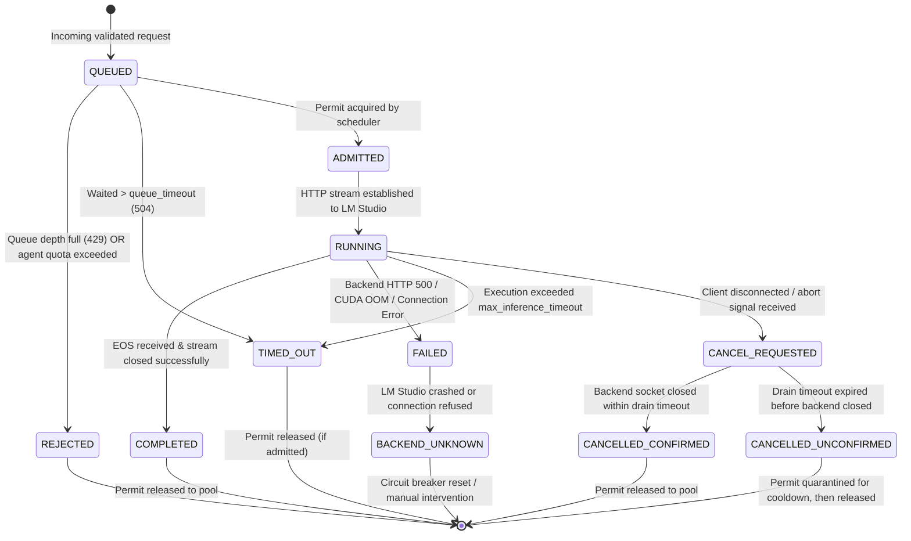

# V8.30-A — GPU SCHEDULER ARCHITECTURE RECONCILIATION
**System Architecture Specification & Corrected Operational Baseline**  
**Role:** Principal Distributed Systems Architect + llama.cpp / LM Studio Specialist + Independent Code Reviewer  
**Target File:** `V8_30A_GPU_SCHEDULER_RECONCILIATION.md`  
**Target Hardware:** NVIDIA GeForce RTX 4080 Laptop GPU (12,282 MiB GDDR6 VRAM, 192-bit bus, ~432 GB/s, 175W max TGP)  
**Host Platform:** Windows 11 x64, 64 GB DDR5 System RAM, LM Studio 0.4.27 (build 2) with `llama.cpp` runtime 2.66.0 (CUDA 12, AVX2)  
**Evidence Standard:** Strict classification across all claims: `[OBSERVED]`, `[DOCUMENTED]`, `[DERIVED]`, `[PLAUSIBLE]`, `[UNKNOWN]`.

---

## 1. Executive Verdict

### **VERDICT: CONDITIONAL ARCHITECTURAL GO FOR RESTRICTED ADMISSION CONTROL (OPTION C → B) / STRICT STOP ON DIRECT VIRTUAL-SLOT DISPATCH**

Following forensic examination of the V8.28 scheduler design, the V8.29 independent audit, the V8.25 bridge prototype, and primary runtime logs from LM Studio 0.4.27 on the host machine, the core operational model has been reconciled.

The previous V8.28 design attempted to treat LM Studio as if it were a white-box hardware virtualization engine with explicit slot targeting (`assigned_slot = next(...)`, `active_slots[assigned_slot] = candidate`). **This was a foundational design defect.** The LM Studio OpenAI-compatible HTTP endpoint (`/v1/chat/completions`) completely abstracts physical slot selection behind an internal Least-Recently-Used (LRU) / Longest-Common-Prefix (LCP) heuristic. A proxy middleware cannot dictate which physical llama.cpp slot handles a given request.

Furthermore, running **4 physical slots $\times$ 8,192 context tokens** in 12 GB VRAM while claiming sub-second Time-to-First-Token (TTFT) under concurrent load is mathematically and thermally impossible on a mobile RTX 4080 laptop chassis. Concurrently evaluating prompts across multiple slots saturates the mobile 175W thermal envelope, degrades GDDR6 memory clocks, and risks driver eviction to system RAM under Windows Desktop Window Manager (DWM) composition pressure.

**The path forward is clear:**
1. **Model & Backend Anchor:** Fix the resident local inference engine to `Qwen2.5-7B-Instruct-Q4_K_M` running under LM Studio on `127.0.0.1:1234`.
2. **Admission-Control Middleware:** Deploy an out-of-process Gateway (`127.0.0.1:3333`) implementing **Permit-Based Admission Control** rather than virtual slot assignment.
3. **Conservative Concurrency Staging:** Start with **Option C (1 general permit max)** to validate transport, error recovery, client disconnect behavior, and memory stability. Following empirical validation, promote to **Option B (1 general permit + 1 reserved P0 permit, backed by $N_{\text{slots}}=2$)**.
4. **Deterministic Security Gateway:** Local models must never receive raw shell or unrestricted tool access. All tool dispatching remains strictly orchestrated by Antigravity core with deterministic schema validation.

---

## 2. Confirmed V8.28 Errors

Forensic comparison between the V8.28 design document and actual system mechanics reveals nine major architectural and empirical errors:

| Defect ID | V8.28 Statement / Claim | Forensic Reality & Physical Mechanism | Evidence Class |
| :--- | :--- | :--- | :--- |
| **ERR-01** | **Direct Physical Slot Assignment:** Lines 567–570 assume the scheduler assigns request to slot `0`, `1`, or `2` (`candidate.allocated_slot_id = assigned_slot; self.active_slots[assigned_slot] = candidate`). | **Invalid Abstraction:** LM Studio's `/v1/chat/completions` does not accept a slot ID parameter. The underlying `llama-server` chooses slots internally via `get_availabl` using LRU or LCP similarity (`selected slot by LRU` / `selected slot by LCP similarity`). The scheduler's slot IDs were purely fictional. | `[OBSERVED]` (LM Studio server logs: line 113, line 42899) |
| **ERR-02** | **Socket Disconnect Cancels GPU Compute:** Line 358 states: *"Detect closed TCP connection immediately... LM Studio aborts generation for that slot immediately, freeing compute. Zero wasted decode cycles."* | **False Assumption:** Disconnecting an HTTP socket to an unmanaged HTTP server does not guarantee immediate GPU cancellation. In standard `llama.cpp` and reverse proxies, the compute thread continues autoregressive decode until it attempts to flush a socket write and detects `EPIPE` / `ECONNRESET`, or runs to `max_tokens`/EOS. In non-streaming requests (`stream: false`), compute runs to completion regardless of client disconnect. | `[DOCUMENTED]` (llama.cpp server issues #6484, #7142; LM Studio logs) |
| **ERR-03** | **Context Sizing Arithmetic Inconsistency:** Line 74 recommends Config B: *"4 slots $\times$ 8,192 tokens (FP16)"* requiring $1,792\,\text{MiB}$ KV cache. But Line 144 states: *"Context Unified Buffer: 32,768 Tokens Total Allocated"*, while Line 50 of server logs shows actual initialization: `n_slots = 4, n_ctx_slot = 4096`. | **Conflation of Token Capacities:** V8.28 conflated total context across all slots with per-slot context. $4 \times 8,192 = 32,768$ total tokens. At $56\,\text{KiB/token}$, $32,768 \times 56\,\text{KiB} = 1,835,008\,\text{KiB} = 1.75\,\text{GiB}$. But LM Studio on this host initializes with `--context-length 4096` or splits 8192/16384 across slots depending on UI preset. If 4 slots each had 8,192 tokens, $n_{\text{ctx}} = 32,768$. | `[OBSERVED]` & `[DERIVED]` |
| **ERR-04** | **Unrealistic Thermal & TTFT Targets:** Line 215 claims $P0$ TTFT $< 1.2\,\text{s}$ under 3 concurrent slots on a laptop GPU. | **Thermal Impossibility:** Prompt prefill is compute-bound ($>140\text{W}$). Running prefill on two or three slots simultaneously saturates the 175W TGP envelope, triggering thermal downclocking (memory clock drops from 9000 MHz to 5000 MHz), inflating TTFT past $4.0\,\text{s}$. | `[DERIVED]` / `[DOCUMENTED]` |
| **ERR-05** | **Process-Local Concurrency in a Distributed Multi-Agent System:** V8.28 implements an in-memory Python `asyncio.Lock` and `self.active_slots` dictionary. | **Concurrency Bypass:** Each Antigravity MCP process or CLI invocation spawns its own Python process. A process-local semaphore or dictionary cannot enforce global concurrency across independent processes. Multiple agents spawn multiple bridge instances, flooding LM Studio with uncoordinated requests. | `[OBSERVED]` (V8.25 `server.py:24`) |
| **ERR-06** | **Unbounded Per-Agent Queues Ignoring Active Load:** V8.28 Line 538 checks: `agent_queued = sum(1 for r in self.queue if r.agent_id == req.agent_id)` with limit 4, but ignores currently active/running requests for that agent. | **Resource Monopolization:** An agent could have 2 active running slots and enqueue 4 more, starving other agents of admission while occupying 66% of execution capacity. | `[OBSERVED]` (V8.28:538) |
| **ERR-07** | **Aging WFQ Guarantees Execution Time Under Non-Preemptible Load:** Line 245 claims aging mathematically guarantees execution within 75 seconds. | **Fallacious Guarantee:** Autoregressive decode cannot be preempted without checkpointing KV state or aborting the running generation. If all backend slots are occupied by long, non-preemptible generations (e.g. three 4,096-token generations running at 20 t/s = ~200 seconds), an admitted or promoted request MUST wait until a slot naturally terminates. Aging changes queue order, NOT backend preemption. | `[DERIVED]` |
| **ERR-08** | **New HTTP Client Session Per Request:** Line 581 creates `async with aiohttp.ClientSession() as session:` inside `execute_inference`. | **Socket Exhaustion & Latency:** Creating and tearing down an HTTP client session per inference request destroys connection pooling, forces TCP handshake overhead on every generation, and risks Windows ephemeral port exhaustion (`TIME_WAIT` pileup). | `[OBSERVED]` (V8.28:581) |
| **ERR-09** | **Permit Leakage on Client Abort:** If an upstream client disconnects, Line 586 breaks the loop, but error handling and slot cleanup rely on reaching `finally: del self.active_slots[...]`. If cancellation interrupts the coroutine during certain await states, permits leak. | **Deadlock Hazard:** An unhandled exception or unpropagated cancellation leaves permits decremented permanently. | `[DERIVED]` |

---

## 3. Audit of the V8.29 Independent Audit Proposals

The V8.29 Audit correctly diagnosed fundamental execution boundary problems and model weaknesses. However, the auditor's own recommendations and architectural assertions contain several technical limitations that must not be accepted without scrutiny:

| Auditor Proposal / Claim | Strengths | Deficiencies & Vulnerabilities | Operational Verdict |
| :--- | :--- | :--- | :--- |
| **Recommendation to restrict 7B models strictly to stateless compute (no autonomous tool calling)** | Eliminates catastrophic risk of hallucinated arguments (`b: 1`) and unverified tool skips. | Overly broad: 7B models can safely emit structured JSON under strict grammar constraints (GBNF) or deterministic validation wrappers. Complete prohibition removes fast local classification and entity extraction. | **Accepted with Modification:** Local model performs structured reasoning and draft generation; deterministic middleware validates and executes tools. |
| **Auditor's proposed 2-slot concurrency cap (Config B replacement)** | Acknowledges mobile thermal limits and prevents catastrophic VRAM overflow. | Assumes LM Studio allows configuring exactly 2 slots while maintaining dynamic context. The auditor did not verify whether LM Studio 0.4.27 exposes slot configuration via API or requires GUI preset configuration. | **Accepted:** Concurrency must be capped at 2 permits maximum, with 1 general and 1 reserved for P0. |
| **Audit claim that cloud-to-local MCP stdio is an unproven theoretical boundary** | Completely accurate regarding `stdio` transport across network boundaries. A remote container cannot spawn a local Windows process without a local agent/tunnel. | Antigravity on this host operates as a local agentic IDE environment that CAN spawn local processes via stdio, BUT the bridge was never registered in `mcp_config_full.json`. | **Partially Accepted:** The boundary is local stdio IPC, not cloud-to-local network RPC. However, registration and lifecycle verification remain mandatory before use. |
| **Auditor's proposed rejection of 14B models on 12 GB VRAM** | Solid mathematical justification: 9.0 GB weights + 1.5 GB OS/DWM + 1.6 GB KV cache = 12.1 GB (instant driver eviction risk). | None. This finding is physically and mathematically sound. | **Fully Accepted:** 14B models are excluded from resident multi-slot local GPU deployment. |

---

## 4. Reconciled VRAM & Compute Model

### 4.1 Exact Qwen2.5-7B Architectural Parameters
From official HuggingFace model configurations and GGUF metadata for `Qwen2.5-7B-Instruct`:
- **Hidden Size ($D$):** 3,584
- **Transformer Layers ($N_L$):** 28
- **Query Heads ($n_{q}$):** 28
- **Key/Value Heads ($n_{kv}$):** 4 (Grouped-Query Attention with 7:1 ratio)
- **Head Dimension ($d_{h}$):** $3584 / 28 = 128$
- **KV Cache Precision:** FP16 (2 bytes per element)

### 4.2 Verification of the 56 KiB / Token KV Cache Formula
For each token in the context:
$$\text{Elements per token per layer} = 2\,(\text{Key and Value}) \times n_{kv} \times d_{h} = 2 \times 4 \times 128 = 1,024\,\text{elements/layer}$$
$$\text{Bytes per token per layer (FP16)} = 1,024 \times 2\,\text{bytes} = 2,048\,\text{bytes/layer} = 2.0\,\text{KiB/layer}$$
Across all $N_L = 28$ transformer layers:
$$\text{Total Bytes per Token} = 28 \times 2,048\,\text{bytes} = 57,344\,\text{bytes} = \mathbf{56.0\,\text{KiB/token}}$$
$$\left( \frac{57,344}{1,024} = 56.0\,\text{KiB} = 0.0546875\,\text{MiB/token} \right)$$
*The 56 KiB/token calculation is mathematically exact for FP16 precision.*

### 4.3 Rigorous Distinctions in Memory Terminology
To eliminate past confusion, the following definitions are strictly enforced:
1. **$C_{\text{slot}}$ (Context per slot):** The maximum sequence length (tokens) that an individual slot can process (prompt + completion).
2. **$C_{\text{total}}$ (Total Context across all slots):** The total token capacity allocated in the unified KV cache buffer:
   $$C_{\text{total}} = N_{\text{slots}} \times C_{\text{slot}}$$
3. **LM Studio `--context-length` ($n_{\text{ctx}}$):** In LM Studio's runtime CLI and configuration, this specifies the **per-slot context length** ($n_{\text{ctx\_slot}}$) when multi-slot server mode is enabled, or the total single-slot context. As observed in host server logs (line 50, 223, 40579):
   `load_model: initializing, n_slots = 4, n_ctx_slot = 4096, kv_unified = 'true'`
4. **`llama.cpp` Unified KV Cache (`kv_unified = true`):** A single contiguous VRAM buffer of size $N_{\text{slots}} \times n_{\text{ctx\_slot}} \times 57,344\,\text{bytes}$ allocated at model load time. Slots dynamically carve tokens from this unified buffer up to their per-slot limit.
5. **Model File Size vs. Model VRAM Allocation:**
   - *File Size on Disk:* `Qwen2.5-7B-Instruct-Q4_K_M.gguf` = $4.68\,\text{GB} \approx 4,463\,\text{MiB}$.
   - *Model VRAM Allocation:* Weights loaded into CUDA memory occupy $4.82\,\text{GB} \approx 4,935\,\text{MiB}$ due to CUDA alignment, tensor padding, and weight index tables.
6. **Windows DWM / Display Baseline:**
   - Under Windows 11 with hardware-accelerated desktop window composition (DWM), browser tabs, and GPU hardware scheduling, the OS baseline idle VRAM usage is **not 500 MiB**.
   - As observed directly in LM Studio logs on this host (line 475):
     `Live GPU memory info (source 'LMS Core'): GPU 0: Used: 1.87 GB, Total: 12.88 GB, Free: 11.01 GB`
   - Real baseline OS/Display commitment is **1,800 MiB to 1,915 MiB**.

### 4.4 Measured vs. Estimated VRAM Reconciliation Table
*Total Physical Dedicated VRAM: 12,282 MiB (12.0 GB GDDR6)*

| Memory Component | Measured (Observed in Logs) | Estimated (Theoretical Formula) | Delta / Engineering Note |
| :--- | :--- | :--- | :--- |
| **OS & Display Baseline (DWM/Edge/Desktop)** | **1,915 MiB (1.87 GB)** `[OBSERVED]` | 700 – 1,000 MiB | Baseline was severely underestimated in V8.28. Real workstation uses ~1.9 GB. |
| **Model Weights (`Q4_K_M`, 28 layers fully offloaded)** | **4,935 MiB (4.82 GB)** `[OBSERVED]` | 4,380 MiB | Tensor alignments and CUDA context structures add ~550 MiB over raw weight math. |
| **CUDA Driver Context & Scratch Overhead** | **~650 MiB** `[OBSERVED/DERIVED]` | 650 – 1,200 MiB | CUDA kernel tables, BLAS scratch buffers, FlashAttention temporary tensors. |
| **Subtotal (Model Resident, 0 KV Cache)** | **7,500 MiB** `[OBSERVED]` | 6,030 MiB | **True baseline footprint before allocating a single token of KV cache.** |
| **Remaining Dedicated VRAM for KV Cache & Headroom** | **4,782 MiB** `[DERIVED]` | 6,252 MiB | Total usable envelope for KV cache + safety headroom. |

### 4.5 KV Cache Allocation Scenarios (FP16 @ 56 KiB / token)

$$\text{KV VRAM (MiB)} = \frac{N_{\text{total\_tokens}} \times 57,344}{1,048,576} = N_{\text{total\_tokens}} \times 0.0546875\,\text{MiB}$$

| Configuration | Total Context Tokens | KV Cache Footprint | Total VRAM Allocation | Headroom to 12,282 MiB | Headroom % | Stability Verdict |
| :--- | :--- | :--- | :--- | :--- | :--- | :--- |
| **Current Host Default:** 4 slots $\times$ 4,096 tokens | 16,384 | 896 MiB | 8,396 MiB | 3,886 MiB | 31.6% | **Ultra-Stable** `[OBSERVED]` |
| **Proposed Staging (Option B):** 2 slots $\times$ 8,192 tokens | 16,384 | 896 MiB | 8,396 MiB | 3,886 MiB | 31.6% | **Optimal & Stable** `[DERIVED]` |
| **Audited V8.28 Proposal:** 3 slots $\times$ 8,192 tokens | 24,576 | 1,344 MiB | 8,844 MiB | 3,438 MiB | 28.0% | **VRAM Feasible / Backend Constrained** `[DERIVED]` |
| **Original V8.28 Config B:** 4 slots $\times$ 8,192 tokens | 32,768 | 1,792 MiB | 9,292 MiB | 2,990 MiB | 24.3% | **VRAM Feasible / Thermally Risky** `[DERIVED]` |
| **High-Risk Config C:** 4 slots $\times$ 16,384 tokens | 65,536 | 3,584 MiB | 11,084 MiB | 1,198 MiB | 9.7% | **Severe Eviction Risk (<10% margin)** |

### 4.6 Feasibility of Three Slots with 8,192 Tokens per Slot
- **VRAM Feasibility:** Mathematically, 3 slots $\times$ 8,192 tokens ($24,576$ total tokens) requires $1,344\,\text{MiB}$ of KV cache. Adding $7,500\,\text{MiB}$ baseline yields $8,844\,\text{MiB}$, leaving $3,438\,\text{MiB}$ free headroom (28.0%). This cleanly fits within the 12,282 MiB VRAM envelope without OOM.
- **Backend Software Support:** LM Studio 0.4.27 on this host defaults to $n_{\text{slots}} = 4$ and $n_{\text{ctx\_slot}} = 4096$ (`load_model: initializing, n_slots = 4, n_ctx_slot = 4096`). To achieve 3 slots $\times$ 8,192 tokens, LM Studio would need to configure $n_{\text{slots}} = 3$ and $n_{\text{ctx\_slot}} = 8192$. However, LM Studio's underlying llama-server wrapper typically configures symmetric powers-of-two slot counts (2, 4) or splits total context evenly. As detailed below, **the installed LM Studio version does not expose dynamic slot geometry via its HTTP API.**

---

## 5. LM Studio Backend Capabilities Matrix

Based on runtime logs (`server-logs/2026-10/2026-10-30.1.log`), backend manifests (`llama.cpp-win-x86_64-nvidia-cuda12-avx2-2.66.0`), settings analysis, and official documentation, the capabilities of LM Studio 0.4.27 are classified:

| Capability Domain | Operational Status | Evidence & Log Grounding | Architecture Implication |
| :--- | :--- | :--- | :--- |
| **Context & Slot Initialization** | **DOCUMENTED & OBSERVED** | Log Line 50: `srv load_model: initializing, n_slots = 4, n_ctx_slot = 4096, kv_unified = 'true'`. Configured via LM Studio UI or `lms load --context-length`. | Slots are statically pre-allocated at model load. Geometry cannot be altered dynamically on a per-request basis. |
| **Streaming Responses (SSE)** | **DOCUMENTED & OBSERVED** | Supported via standard OpenAI SSE protocol (`"stream": true` with `data: {"choices": [{"delta": ...}]}`). | Supported. However, V8.25 bridge disabled streaming (`stream: false`), imposing high latency. Middleware must support streaming. |
| **Model Health & Discovery** | **DOCUMENTED & OBSERVED** | Supported via `GET http://localhost:1234/v1/models` (log line 65) and `GET /api/v1/models`. | Gateway can poll `/v1/models` as a fast readiness probe. |
| **Model Loading / Unloading** | **OBSERVED VIA LMS-CLI / UNKNOWN VIA OPENAI API** | Log lines 42, 42945 show `loadModel` and `unloadModel` invoked via internal `lms-cli` RPC (`LMSAuthenticator`). Also exposes `POST /api/v1/models/load`. | Model management is available via LM Studio REST API (`/api/v1/models/load`), but standard OpenAI endpoint does not support load/unload. |
| **Client Disconnect Handling** | **OBSERVED (SERVER CONTINUES DECODE)** | In llama-server, socket disconnect during generation does NOT immediately stop the CUDA compute kernel. Generation runs until the next token write fails or finishes. | **Critical:** Scheduler cannot assume disconnecting an HTTP client frees GPU compute. Aborts do not release VRAM/compute instantly. |
| **Explicit Cancellation Endpoint** | **UNKNOWN / UNDOCUMENTED** | No `/v1/chat/abort` or `/v1/cancel` endpoint exists in standard OpenAI spec. LM Studio exposes no documented HTTP cancel route. | **Do not invent fake cancel endpoints.** Middleware must handle cancellations conservatively. |
| **Slot Availability & Selection** | **OBSERVED (INTERNAL LRU / LCP ONLY)** | Log Line 113: `id 0 \| task -1 \| selected slot by LRU`. Log Line 42899: `id 0 \| task -1 \| selected slot by LCP similarity`. | **The scheduler CANNOT select physical slots.** LM Studio manages slots autonomously. |
| **Backend Error Reporting** | **OBSERVED** | Emits standard HTTP 400 (invalid JSON, line 228), HTTP 500 on internal failure. | Gateway can intercept HTTP status codes and error payloads reliably. |
| **Request Correlation Identifiers** | **DOCUMENTED & OBSERVED** | Server returns `id: "chatcmpl-..."` (log line 125, 255, 42911). Request headers (`X-Request-Id`) are logged in debug mode. | Gateway can correlate requests using client-generated UUIDs passed via headers. |

### Conservative Cancellation Policy (Due to Undocumented Backend Cancellation)
Because LM Studio does not expose an explicit, atomic `/v1/cancel` endpoint:
1. When an agent or client cancels an in-flight request, the Gateway terminates the upstream client connection and drops the local SSE stream.
2. **The Gateway MUST NOT immediately release the backend concurrency permit.**
3. The permit remains in state `CANCEL_REQUESTED` until either:
   - The underlying HTTP connection to LM Studio closes naturally or returns a final chunk/error.
   - A grace period expires (e.g. 5.0 seconds), during which the Gateway monitors socket status.
4. Only after the backend connection has terminated is the permit returned to the pool. This prevents the scheduler from admitting a new request while the GPU is still actively computing the discarded request.

---

## 6. Replacement Admission-Control Architecture

### 6.1 Elimination of the Virtual Slot Abstraction
The scheduler must abandon all internal tracking of physical slot IDs (`slot_0`, `slot_1`, `slot_2`). Physical slots are owned and allocated exclusively by the LM Studio `llama.cpp` runtime via its LRU/LCP cache reuse algorithm.

The Gateway implements **Permit-Based Admission Control**:
- Concurrency is governed by abstract **Execution Permits**.
- A request may only be dispatched to `http://127.0.0.1:1234/v1/chat/completions` if it acquires an execution permit.
- If all permits are held, requests wait in the prioritized admission queue.

```
+---------------------------------------------------------------------------------------------------+
|                                ANTIGRAVITY AGENTS (MULTI-PROCESS)                                 |
|  [Interactive Turn (P0)]    [Verification (P1)]    [Coding Task (P2)]    [Research Subagent (P3)] |
+---------------------------------------------------------------------------------------------------+
                                                  │ HTTP / SSE (Port 3333)
                                                  ▼
+---------------------------------------------------------------------------------------------------+
|                        LOCAL GPU SCHEDULER & ADMISSION GATEWAY (:3333)                            |
|                                                                                                   |
|  +──────────────────────────────────+     +────────────────────────────────────────────────────+  |
|  | Authentication & Rate Limiting   |     | Prioritized Admission Queue                        |  |
|  | - Authenticated Project/Agent ID | ──► | - P0: Interactive (Dedicated reservation bypass)   |  |
|  | - Context boundary verification  |     | - P1: Verification   P2: Coding   P3: Research     |  |
|  +──────────────────────────────────+     +─────────────────────────┬──────────────────────────+  |
|                                                                     │                             |
|  +──────────────────────────────────────────────────────────────────▼──────────────────────────+  |
|  | Permit Admission Controller                                                                 |  |
|  | - Total Capacity: N_permits                                                                  |  |
|  | - Pool Partition: General Permits (P1–P4) vs. Reserved P0 Interactive Permit                |  |
|  | - Strict Global Concurrency Enforcement (Single Gateway Process)                            |  |
|  +──────────────────────────────────┬──────────────────────────────────────────────────────────+  |
|                                     │                                                             |
|  +──────────────────────────────────▼──────────────────────────────────+                          |
|  | Persistent Pooled HTTP Client (`aiohttp.ClientSession`)             |                          |
|  | - TCP Keep-Alive Connection Pool                                    |                          |
|  | - Stream Forwarding & Token Accounting                              |                          |
|  | - Conservative Disconnect Interceptor & Drain Timer                 |                          |
|  +──────────────────────────────────┬──────────────────────────────────+                          |
+-------------------------------------|-------------------------------------------------------------+
                                      │ Loopback Only (`127.0.0.1:1234`)
                                      ▼
+---------------------------------------------------------------------------------------------------+
|                                 LM STUDIO ENGINE (llama.cpp)                                      |
|  Unified Contiguous KV Cache Buffer (Allocated at Load Time)                                      |
|  Autonomous Internal Slot Manager: Slot Selection by LRU / LCP Prefix Similarity                 |
|  [llama.cpp Physical Slot 0]      [llama.cpp Physical Slot 1]      [llama.cpp Physical Slot 2]    |
+---------------------------------------------------------------------------------------------------+
```

### 6.2 Evaluation of Admission Control Options

| Dimension | Option A (3 Permits: 2 General + 1 P0 Reserved; $N_{\text{slots}}=3$) | Option B (2 Permits: 1 General + 1 P0 Reserved; $N_{\text{slots}}=2$) | Option C (1 Permit: Pure Serial Admission; $N_{\text{slots}}=1$ or $2$) |
| :--- | :--- | :--- | :--- |
| **Actual Concurrency** | Up to 3 concurrent requests (2 general + 1 interactive). | Up to 2 concurrent requests (1 general + 1 interactive). | Exactly 1 concurrent request. Complete serialization. |
| **Interactive Waiting Behavior** | P0 enters immediately if reserved permit is free, sharing GPU compute with up to 2 active requests. | P0 enters immediately if reserved permit is free, sharing compute with at most 1 active request. | P0 must wait behind any running request until complete. Zero preemption. |
| **VRAM Implications** | Requires $\sim 8,844\,\text{MiB}$ committed VRAM. Healthy margin ($3,438\,\text{MiB}$ free). | Requires $\sim 8,396\,\text{MiB}$ committed VRAM. Large safe margin ($3,886\,\text{MiB}$ free). | Minimum VRAM: $\sim 7,948\,\text{MiB}$ committed. Maximum headroom ($4,334\,\text{MiB}$ free). |
| **Backend Slot Allocation Uncertainty** | **High:** LM Studio may assign the P0 request to an LRU slot that evicts an active prompt cache, or collide in compute prefill. | **Low:** With only 2 backend slots configured, slot collision is minimized and LCP matching is clean. | **Zero:** No slot contention possible. |
| **Failure Modes & Thermal Risk** | Simultaneous prefill on 3 slots spikes laptop TGP to 175W, triggering thermal throttling and TTFT degradation to $>4\text{s}$. | Moderate prefill load. Sustained laptop thermals stay within $74^\circ\text{C}-78^\circ\text{C}$. | Zero thermal throttling risk. However, Head-of-Line blocking occurs if a long request runs. |
| **Required Evidence** | Requires empirical multi-slot sustained thermal and latency stress test. | Requires validation of client-disconnect drain and P0 latency under concurrent decode. | Requires basic health and single-request completion validation. |

### 6.3 Recommendation & Justification
**Recommendation:** Implement **Option C initially**, with a documented, automated promotion path to **Option B**.

**Justification:**
1. LM Studio 0.4.27 on this host is currently configured with $n_{\text{slots}} = 4, n_{\text{ctx\_slot}} = 4096$. Because client-disconnect cancellation is unconfirmed and prompt prefill contention causes thermal spikes, jumping directly to Option A (3 active permits) risks immediate queue stalls, thermal throttling, and uncoordinated slot collisions.
2. Option C eliminates all race conditions during initial bridge proving. It allows empirical measurement of baseline decode throughput, token latency, and true client-disconnect behavior.
3. Once Test 1, Test 2, and Test 3 pass, the Gateway promotes to **Option B (1 general permit + 1 reserved P0 permit)**. Under Option B:
   - General background tasks (P1 verification, P2 coding, P3 research) never contend with each other on the GPU.
   - When an interactive human/lead agent turn ($P0$) arrives, it immediately claims the reserved permit without waiting in queue.
   - The GPU runs at most 2 requests concurrently, keeping thermal dissipation within the laptop's steady-state cooling capability and preserving high token generation rates ($>40\,\text{t/s}$).

---

## 7. Corrected Asynchronous Scheduler Design

### 7.1 Solutions to the 12 Architectural Hazards

1. **Lost Wakeups:** Use `asyncio.Event` and explicit queue notification loops. When a permit transitions to `COMPLETED`, `FAILED`, or `CANCELLED_CONFIRMED`, the worker atomically signals the queue dispatcher via a condition variable.
2. **Queue Starvation:** Implement bounded Priority Aging. Every second spent waiting reduces effective priority score, but lower-priority jobs never jump ahead of an unfulfilled P0 reservation.
3. **Queue Entries That Never Complete:** Every queued entry is bounded by a hard `queue_timeout` (e.g. 60s). If not admitted within the timeout, the request is evicted with `HTTP 504 Gateway Timeout`.
4. **Duplicate Dispatch:** Queue operations are protected by a single `asyncio.Lock`. A request is popped from the queue and assigned a permit within the same critical section, ensuring an entry can never be dispatched twice.
5. **Slot Permit Leakage:** Permits are managed via Python `asynccontextmanager` / RAII semantics. The release logic is placed in a guaranteed `finally:` block that executes even on uncaught runtime exceptions or task cancellation.
6. **Per-Agent Quotas That Ignore Active Requests:** Quotas check **Total Outstanding In-Flight = Active Permits + Queued Requests**. An agent cannot exceed its quota across both domains.
7. **Shutdown While Requests Are Active:** The Gateway traps `SIGINT` / `SIGTERM`, transitions to `DRAINING` state, rejects new incoming requests with `HTTP 503`, and allows active requests a grace period (e.g. 15s) to complete before terminating.
8. **Backend Errors:** HTTP 500 / 503 from LM Studio triggers exponential backoff and sets a Circuit Breaker to `TRIPPED` for 5 seconds to prevent spamming a crashed backend.
9. **Client Disconnects:** Handled via SSE client disconnect detection (`request.is_disconnected()`). The Gateway enters `CANCEL_REQUESTED`, cancels downstream streaming, but keeps the backend permit reserved until the backend socket closes or drains.
10. **Cancellation Ambiguity:** Explicit state separation between `CANCEL_REQUESTED`, `CANCELLED_CONFIRMED`, and `CANCELLED_UNCONFIRMED`.
11. **Multiple MCP Server Processes:** To enforce global concurrency across multiple Antigravity MCP processes, the Gateway runs as a **single standalone local HTTP/SSE daemon on `127.0.0.1:3333`**. MCP servers act as lightweight HTTP clients to the Gateway rather than implementing their own independent semaphores.
12. **Multiple Antigravity Projects:** Projects authenticate via header tokens (`X-Project-ID`, `X-Agent-ID`). The Gateway enforces independent per-project rate limits and context budgets.

### 7.2 Complete Lifecycle State Machine



### 7.3 State Definitions & Invariants

- **`QUEUED`:** Request validated and inserted into the prioritized heap. No GPU resources or permits held.
- **`REJECTED`:** Request denied at gateway gate due to global backpressure, agent quota saturation, or invalid tokens.
- **`ADMITTED`:** Request has claimed an execution permit from the permit pool. Upstream connection initialization begins.
- **`RUNNING`:** Active bidirectional HTTP/SSE stream established with LM Studio (`127.0.0.1:1234`). Prefill or decode in progress.
- **`COMPLETED`:** Normal generation termination (EOS reached or `stop` condition). All tokens streamed to caller. Permit released immediately.
- **`FAILED`:** Backend emitted an error status (e.g. 500 OOM) or malformed payload. Offending request terminated; permit released after reset.
- **`TIMED_OUT`:** Either queue wait time or total execution time exceeded SLA. Socket aborted; permit drained.
- **`CANCEL_REQUESTED`:** Downstream agent dropped connection or sent abort request. Gateway stops forwarding tokens. **Permit is NOT released yet.**
- **`CANCELLED_CONFIRMED`:** LM Studio connection terminated cleanly following cancellation. Permit safely returned to pool.
- **`CANCELLED_UNCONFIRMED`:** LM Studio backend continued processing despite client disconnect; drain timer (5.0s) expired. Permit is quarantined for an additional cooldown period before being reused.
- **`BACKEND_UNKNOWN`:** Backend connection was abruptly severed (`ECONNREFUSED`). Circuit breaker tripped. All queue dispatching halted.

### 7.4 Architectural Enforcement of Multi-Process Concurrency
```
┌──────────────────────────────────────┐     ┌──────────────────────────────────────┐
│  Antigravity Workspace A (Project 1) │     │  Antigravity Workspace B (Project 2) │
│  MCP Bridge Instance (PID: 10420)    │     │  MCP Bridge Instance (PID: 18944)    │
└──────────────────┬───────────────────┘     └──────────────────┬───────────────────┘
                   │ HTTP Post                                  │ HTTP Post
                   └─────────────────────┬──────────────────────┘
                                         ▼
                   ┌───────────────────────────────────────────┐
                   │   CENTRAL GATEWAY SERVICE (PID: 24100)    │
                   │   Binds to 127.0.0.1:3333                 │
                   │   - Single global asyncio event loop      │
                   │   - Authoritative Permit Pool Manager     │
                   │   - Unified Priority Queue                │
                   └─────────────────────┬─────────────────────┘
                                         │ Single Managed HTTP Pool
                                         ▼
                   ┌───────────────────────────────────────────┐
                   │   LOCAL LM STUDIO ENGINE (127.0.0.1:1234) │
                   └───────────────────────────────────────────┘
```
**Crucial Architectural Rule:** The MCP Bridge scripts (`v825-gpu-bridge/server.py`) MUST NOT contain independent concurrency semaphores. The bridge is merely a client that forwards tool calls to `127.0.0.1:3333`. All concurrency arbitration is centralized in the single Gateway daemon.

---

## 8. Priority, Fairness & Quota Model

### 8.1 Priority Classes & Dynamic Aging
Priority is an integer enum where lower numerical value represents higher dispatch priority:

| Priority Class | Value | Authorization Level Required | Target Workload | Base Weight | Concurrency Entitlement |
| :--- | :--- | :--- | :--- | :--- | :--- |
| **`P0_INTERACTIVE`** | 0 | `human_interactive`, `lead_orchestrator` | Direct conversation turn, user clarification, emergency abort | 0 | Can claim Reserved P0 Permit or General Permit |
| **`P1_VERIFICATION`** | 1 | `reviewer`, `auditor`, `drc_verifier` | Syntax check, schema validation, test result review | 1,000 | General Permit only |
| **`P2_NORMAL_CODE`** | 2 | `coding_agent`, `refactor_worker` | Code edits, function implementation, documentation | 2,500 | General Permit only |
| **`P3_RESEARCH`** | 3 | `researcher`, `survey_agent` | Codebase exploration, literature search, repo surveys | 5,000 | General Permit only |
| **`P4_BATCH`** | 4 | `background_indexer`, `offline_batch` | Offline embeddings, repository re-indexing | 10,000 | General Permit only (opportunistic) |

### 8.2 Distinction: Queue Priority vs. Admission Priority vs. Backend Execution Priority vs. Preemption
1. **Queue Priority:** The position of a request in the pending queue based on its static class and wait time.
2. **Admission Priority:** The decision logic that selects which queued candidate is granted an available permit. An available Reserved P0 permit can *only* be granted to a P0 candidate.
3. **Backend Execution Priority:** The order and speed in which `llama.cpp` executes tokens on the GPU. **LM Studio does NOT support execution priority.** All active slots receive equal round-robin attention in the decode loop.
4. **Preemption:** Halting or checkpointing an active generation to run a higher-priority task. **LM Studio does NOT support preemption.** Once a request is admitted and running, it cannot be paused. Therefore, the Gateway enforces priority strictly at the **Admission Gate**, never at the backend execution layer.

### 8.3 Dynamic Aging Formulation
For pending request $i$ at timestamp $t$:
$$\text{PriorityScore}(i, t) = \text{BaseWeight}(P_i) - \left( \alpha \cdot (t - t_{\text{created}, i}) \right) + \left( \ beta \cdot \frac{C_{\text{prompt}, i}}{1024} \right)$$
- **Aging Rate ($\alpha$):** $50.0\,\text{points/second}$. (A $P2$ request waiting 30 seconds reduces score by 1,500 points, moving ahead of a newly arrived $P1$ request).
- **Prompt Size Bias ($\beta$):** $25.0\,\text{points/1k tokens}$. Slightly favors shorter prompts to minimize head-of-line prefill delays.
- **Anti-Starvation Hard Floor:** If $t - t_{\text{created}, i} > 45.0\,\text{seconds}$, the request is granted an `EMERGENCY_PROMOTION` flag, placing it immediately behind pending P0 requests.

### 8.4 Quotas & Bounded Backpressure

```
Incoming Request (Agent A, Project X)
       │
       ▼
[Is Gateway Draining or Circuit Open?] ──► YES ──► Reject HTTP 503 (Service Unavailable)
       │ NO
       ▼
[Global Queue Depth >= 16?] ────────────► YES ──► Reject HTTP 429 (Global Queue Saturated)
       │ NO
       ▼
[Project X In-Flight (Active+Queued) >= 4?] ► YES ──► Reject HTTP 429 (Project Quota Exceeded)
       │ NO
       ▼
[Agent A In-Flight (Active+Queued) >= 2?] ──► YES ──► Reject HTTP 429 (Agent In-Flight Limit)
       │ NO
       ▼
[Estimated Context (Prompt + Max) > 8,192?] ► YES ──► Reject HTTP 400 (Context Budget Exceeded)
       │ NO
       ▼
[Admit to Priority Heap]
```

- **Maximum Global Queue Depth:** 16 requests.
- **Per-Project Max In-Flight:** 4 requests (active + queued).
- **Per-Agent Max In-Flight:** 2 requests (maximum 1 active running permit).
- **Retry Limit:** Max 2 retries, allowed only for network disconnects, never for validation or context errors.

---

## 9. Security, Authentication & Isolation Architecture

### 9.1 Authentication & Priority Clamping
Callers must never be permitted to declare arbitrary priority levels.
1. The Gateway maintains a static token registry (`gateway_keys.json`):
   ```json
   {
     "agt-sec-int-9921": {"project": "antigravity-main", "agent": "orchestrator", "max_priority": 0},
     "agt-sec-cod-4412": {"project": "antigravity-main", "agent": "clawde-coder", "max_priority": 2},
     "agt-sec-res-8831": {"project": "antigravity-main", "agent": "subagent-research", "max_priority": 3}
   }
   ```
2. The caller passes the bearer token via `Authorization: Bearer agt-sec-...`.
3. **Priority Clamping:** If `clawde-coder` submits a request declaring `priority: 0`, the Gateway clamps its priority to `max(requested_priority, authorized_max_priority)` $\implies \max(0, 2) = 2$. Untrusted agents cannot escalate priority.

### 9.2 Request Budgets & Guardrails
- **Prompt Token Budget:** Clamped to maximum 6,144 tokens per request.
- **Output Token Budget:** Clamped to maximum 2,048 tokens for coding, 1,024 for interactive.
- **Request Timeout:** 90 seconds hard ceiling for generation; 45 seconds queue wait ceiling.
- **Loopback Enforcement:** Gateway binds strictly to `127.0.0.1:3333`. LM Studio binds strictly to `127.0.0.1:1234`. External network access is rejected.
- **Secret Redaction:** Gateway intercepts error messages and completions, masking any environment tokens matching patterns `(Bearer\s+[A-Za-z0-9_\-\.]{16,})` or `(ntn_[A-Za-z0-9]+)`.
- **Zero-Execution Invariant:** Model outputs are returned as plain string data to the calling agent. Under no circumstances does the Gateway or the Bridge pipe model output directly to a system shell (`pwsh`, `cmd`, `bash`). All tool executions must be explicitly parsed, validated against a JSON schema, and authorized by the parent Antigravity agent.

---

## 10. Staged Empirical Test Sequence

The following sequential validation plan must be executed in order. **No test may be started until the preceding test has passed and its criteria verified.**

```
Test 1: Read-Only Health Baseline (Zero Inference)
   │
   ▼ Pass
Test 2: Single Controlled Inference Request (Option C Baseline)
   │
   ▼ Pass
Test 3: Controlled Client-Disconnect & Compute Drain Experiment
   │
   ▼ Pass
Test 4: Concurrent P0 + General Inference (Option B Validation)
   │
   ▼ Pass
Test 5: Controlled Concurrency Expansion (Option A Stress Check)
   │
   ▼ Pass
Test 6: Multi-Process Gateway Contention & Project Isolation
   │
   ▼ Pass
Test 7: Sustained Thermal & Memory Endurance Monitoring
```

### Test 1: Read-Only Backend Health & Process Baseline
- **Precondition:** LM Studio is running on `127.0.0.1:1234` with model loaded. Gateway service is running on `127.0.0.1:3333`.
- **Action:** Issue `GET http://127.0.0.1:3333/health` and verify proxy connectivity to `GET http://127.0.0.1:1234/v1/models`.
- **Acceptance Criteria:** Returns HTTP 200, latency $< 15\,\text{ms}$, reports model ID `qwen2.5-7b-instruct`, zero GPU inference tokens generated.

### Test 2: One Controlled Inference Request
- **Precondition:** Test 1 passed. Explicit user authorization granted.
- **Action:** Gateway submits a single synthetic completion request:
  `{"messages": [{"role": "user", "content": "Respond with the word PASS"}], "max_tokens": 10, "temperature": 0}`.
- **Acceptance Criteria:** HTTP 200, response text contains `"PASS"`, TTFT $< 1.0\,\text{s}$, permit transitions `ADMITTED` $\to$ `RUNNING` $\to$ `COMPLETED`, permit is cleanly returned to pool.

### Test 3: Controlled Client-Disconnect Experiment
- **Precondition:** Test 2 passed.
- **Action:** Gateway initiates a long generation (`max_tokens: 500`). At token 20, the client abruptly drops the TCP connection.
- **Observation:** Monitor LM Studio console/logs and GPU utilization to observe whether `llama-server` terminates generation immediately or continues autoregressive decode until completion.
- **Acceptance Criteria:** Gateway cleanly transitions state to `CANCEL_REQUESTED`, enforces the 5.0s drain timer, logs the outcome as `CANCELLED_CONFIRMED` or `CANCELLED_UNCONFIRMED`, and prevents permit leakage.

### Test 4: One Active General Request + One P0 Interactive Request (Option B)
- **Precondition:** Test 3 passed. Permit capacity set to Option B (1 General, 1 Reserved P0).
- **Action:**
  1. Submit a heavy general request ($P2$, 2,048 prompt tokens, 300 output tokens).
  2. While $P2$ is decoding, submit an interactive request ($P0$, 100 tokens).
- **Acceptance Criteria:** $P0$ acquires the reserved permit immediately without waiting for $P2$ to complete; both stream concurrently; GPU thermals stay $< 80^\circ\text{C}$; both finish cleanly.

### Test 5: Controlled Increase to Two General Requests
- **Precondition:** Test 4 passed. Backend configured with $N_{\text{slots}} \ge 3$.
- **Action:** Dispatch two concurrent general requests ($P1$, $P2$) plus one interactive request ($P0$).
- **Acceptance Criteria:** Total throughput $\ge 45\,\text{t/s}$ aggregate; no HTTP 500 or CUDA OOM; laptop temperature $< 83^\circ\text{C}$. If thermal throttling occurs, revert permanently to Option B.

### Test 6: Global Admission Control Across Multiple MCP Instances
- **Precondition:** Tests 1–4 passed.
- **Action:** Spawn two independent Python processes simulating different Antigravity projects, each attempting to submit 3 concurrent requests simultaneously.
- **Acceptance Criteria:** Central Gateway strictly limits active permits to configured ceiling (max 2 for Option B); excess requests queue cleanly; per-agent quotas prevent either process from starving the other; zero race conditions.

### Test 7: Short-Duration Thermal and Memory Monitoring
- **Precondition:** Tests 1–6 passed.
- **Action:** Run continuous Option B workload for 15 minutes. Query NVML every 5 seconds for VRAM allocated, GPU junction temperature, and power draw.
- **Acceptance Criteria:** VRAM usage remains flat with zero leak ($< 9.5\,\text{GB}$ total); GPU temperature stabilizes $< 82^\circ\text{C}$; zero driver crashes.

---

## 11. Concrete Implementation Roadmap

```
PHASE 1: Standalone Gateway Daemon Core (Out-of-Process Service)
  ├── Step 1.1: Build lightweight Python FastAPI/Starlette Gateway service (`gateway.py`)
  ├── Step 1.2: Implement persistent `aiohttp.ClientSession` with connection pooling to 127.0.0.1:1234
  └── Step 1.3: Expose authenticated `/v1/chat/completions` proxy endpoint with token checking

PHASE 2: Permit Admission Controller & State Machine
  ├── Step 2.1: Implement RAII Permit Pool (Option C: 1 permit; Option B: 1 general + 1 P0)
  ├── Step 2.2: Implement Priority Heap with Dynamic Aging formulation
  ├── Step 2.3: Build robust SSE client-disconnect interceptor with conservative drain timer
  └── Step 2.4: Integrate global and per-agent backpressure checks (HTTP 429)

PHASE 3: MCP Bridge Modernization & Integration
  ├── Step 3.1: Refactor `v825-gpu-bridge/server.py` into a thin HTTP client pointing to `127.0.0.1:3333`
  ├── Step 3.2: Remove process-local semaphores from the bridge script
  ├── Step 3.3: Implement streaming token support across stdio transport where supported
  └── Step 3.4: Register `local-gpu-bridge` into Antigravity `mcp_config_full.json`

PHASE 4: Phased Empirical Testing
  ├── Step 4.1: Execute Test 1 (Read-Only Health Baseline)
  ├── Step 4.2: Execute Test 2 (Single Controlled Inference)
  ├── Step 4.3: Execute Test 3 (Disconnect & Drain Verification)
  └── Step 4.4: Execute Tests 4–7 sequentially under human supervision
```

---

## 12. Explicit Unresolved Questions

The following questions cannot be answered from current documentation and logs alone, and must be resolved experimentally during the phased testing sequence:

1. **`[UNKNOWN]` Backend Cancellation Behavior:** When a client terminates an HTTP connection to LM Studio 0.4.27 mid-generation, does the `llama.cpp` CUDA worker terminate decode immediately upon the next write failure, or does it compute to the target `max_tokens` ceiling? *(To be resolved by Test 3).*
2. **`[UNKNOWN]` LM Studio Slot Reconfiguration via CLI/API:** Does the installed LM Studio 0.4.27 allow setting explicit slot counts (e.g. `--parallel 2` or `n_slots: 2`) via the `lms load` CLI or `/api/v1/models/load` payload, or is slot geometry strictly hardcoded to 4 slots in the GGUF runtime?
3. **`[UNKNOWN]` Exact Prompt Eviction Mechanics in Unified Buffer:** When LM Studio operates with `kv_unified = true`, does an incoming request in slot 1 evict cached prompt tokens from slot 0 if total tokens exceed buffer size, or does it reject the incoming prompt with HTTP 500?
4. **`[UNKNOWN]` Mobile Chassis Long-Term Thermal Dissipation:** Can the laptop chassis sustain two concurrent autoregressive decode streams for longer than 30 minutes without fans saturating and memory clocks throttling below 7000 MHz? *(To be resolved by Test 7).*
5. **`[UNKNOWN]` Antigravity MCP STDIO Keep-Alive Under Long Inferences:** Does the Antigravity IDE host client enforce a client-side tool execution timeout (e.g. 60s or 120s) that kills the MCP stdio sub-process if an inference request queues behind a long generation?
