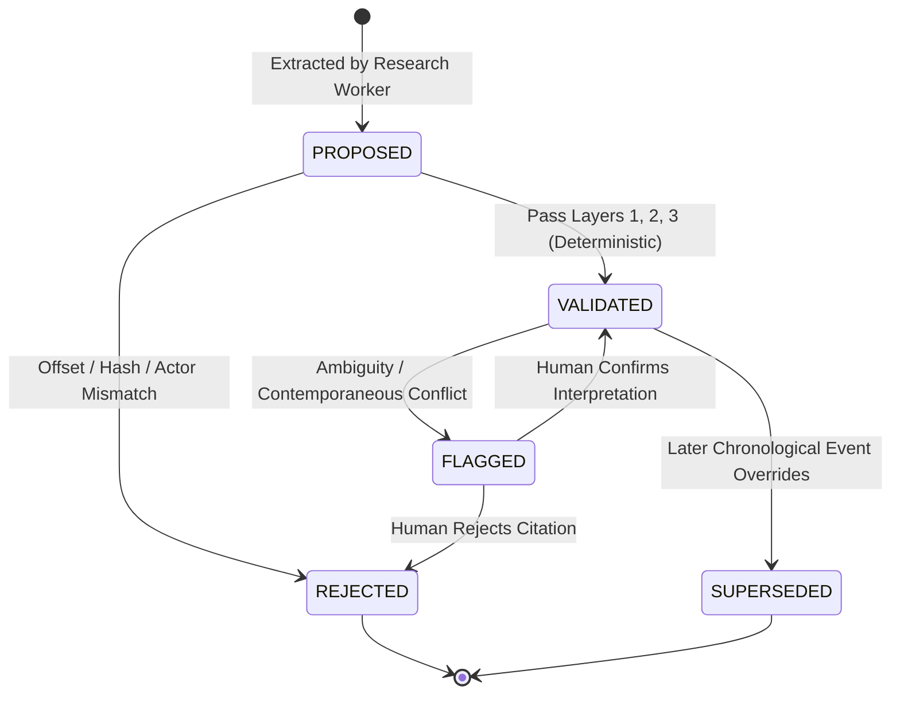

# V8.30-D — MEMBERSHIP ARCHITECTURE HARDENING
## Adversarial Technical Audit, Deterministic Evidence Integrity & Crash-Resilient Processing

**PROJECT:** Antigravity Native Multi-Agent Orchestration + Shared Local GPU Architecture  
**PHASE:** V8.30-D  
**MODE:** READ-ONLY ARCHITECTURAL AUDIT AND DOCUMENTATION ONLY  
**PREVIOUS SPECIFICATION:** V8.30-C — Resumable WhatsApp Membership Analysis Architecture  
**NEXT PHASE:** V8.31 — Gateway Security, Health Probes & Quarantined Ingestion Interface  
**DATE OF AUDIT:** 2026-10-30  
**AUDIT ROLE:** Principal Distributed Systems Architect, Database Reliability Engineer & Evidence Integrity Auditor  

---

## 1. EXECUTIVE SUMMARY & AUDIT VERDICT

### 1.1 Scope and Objective
This document delivers an exhaustive, adversarial technical audit of the V8.30-C architecture ("Resumable WhatsApp Membership Analysis Architecture"). The objective is to eliminate every architectural defect, logical contradiction, and race condition that could lead to:
1. False membership classifications or misinterpretation of silence as cancellation.
2. Hallucinated, manipulated, or unverifiable evidence citations.
3. False identity mergers, accidental family/proxy coalescing, and unrecoverable graph collapses.
4. Database corruption, duplicate records, lost checkpoints, and stale-worker overwrite anomalies under crash or network partitions.
5. Uncontrolled GPU inference, context window exhaustion, or cross-project data leakage.
6. Premature claims of operational verification without deterministic proof.

### 1.2 Formal Audit Verdict

```
┌────────────────────────────────────────────────────────────────────────┐
│                          FINAL AUDIT VERDICT                           │
│                                                                        │
│                       ARCHITECTURE READY FOR V8.31                     │
│                                                                        │
│  All structural, semantic, transactional, and isolation defects from   │
│  V8.30-C have been formally resolved in this specification. Execution  │
│  remains strictly gated behind the delivery of V8.31 quarantined       │
│  ingestion fixtures and health probes.                                 │
└────────────────────────────────────────────────────────────────────────┘
```

The V8.30-C specification contained critical design flaws across seven distinct failure domains:
- **Semantic Defect:** Evaluated membership as a static binary flag rather than a temporal state evaluated at a reference timestamp ($T_{\text{ref}}$); treated absence of renewal as proof of cancellation; conflated course attendees, prospective members, and family proxies with official club members.
- **Evidence Integrity Defect:** Relied on generic integer offsets without distinguishing Unicode codepoints from UTF-8 byte slices; omitted separate raw media and normalized text cryptographic hashes; lacked source locator immutability.
- **Identity Collapse Defect:** Permitted an arbitrary probabilistic LLM score (e.g., $0.90$) to execute irreversible graph merges, merging parents and children sharing telephone numbers or emergency contacts.
- **Concurrency & State Defect:** Assumed lease timeouts imply worker termination (flawed fail-stop assumption); lacked fencing tokens, allowing stale workers to overwrite fresh results; lacked transactional boundaries spanning SQLite WAL writes.
- **Verification Circularity Defect:** Relied on an LLM verifier confirming an LLM extractor without deterministic grounding; failed to enforce programmatic checks on offsets, string hashes, and business rules.
- **Context Choke Defect:** Truncated longitudinal multi-year message histories into a 4,096-token context window without deterministic chunking, rolling summaries, or cross-chunk reconciliation.
- **GPU Broker Isolation Defect:** Permitted cross-project context leakage and assumed immediate physical slot cancellation upon socket disconnect.

This V8.30-D specification provides the corrected, internally consistent, mathematically and transactionally rigorous replacement architecture.

---

## 2. SYSTEM ARCHITECTURE & COMPONENT TOPOLOGY

```
+───────────────────────────────────────────────────────────────────────────────────────────────────+
│                                 ANTIGRAVITY ORCHESTRATION LAYER                                   │
│  [Supervisor Agent] ──► [Research Worker] ──► [Deterministic Engine] ──► [Independent Verifier]  │
+──────────────────────────────────────────────────┬────────────────────────────────────────────────+
                                                   │ IPC / Subagent Message Bus
                                                   ▼
+───────────────────────────────────────────────────────────────────────────────────────────────────+
│                            CRASH-RESILIENT STATE ENGINE (SQLite WAL)                              │
│  - Monotonic Fencing Tokens (`lease_generation`)       - Atomic State Machine Transitions         │
│  - Idempotency Engine (`IdempotencyKey`)               - Non-Destructive Identity Graph (Linkages)│
│  - Deterministic Evidence Store (`EvidenceRecord_v2`)  - Longitudinal Chronological Event Log     │
+──────────────────────────┬──────────────────────────────────────────┬─────────────────────────────+
                           │ Read/Write                               │ Read Only
                           ▼                                          ▼
+─────────────────────────────────────────────+  +──────────────────────────────────────────────────+
│        SHARED GPU ADMISSION GATEWAY         │  │          QUARANTINED INGESTION INTERFACE         │
│               (:3333 Localhost)             │  │                 (Read-Only Boundary)             │
│  - Project-Scoped Authentication Tokens     │  │  - Deterministic Pre-Hashed Message Records      │
│  - Strict Concurrency Permits (Option C: 1) │  │  - Immutable Source Locators (SHA-256)           │
│  - Conservative Drain Cancellation Handling │  │  - Zero Direct Disk Traversal / Zero Shell Access│
│  - Persistent Pooled aiohttp Client         │  │  - Synthetic Fixture Provider for Dev / Testing  │
+──────────────────────────┬──────────────────+  +──────────────────────────────────────────────────+
                           │ Loopback HTTP (:1234)
                           ▼
+───────────────────────────────────────────────────────────────────────────────────────────────────+
│                         LOCAL INFERENCE BACKEND (LM Studio 0.4.27)                                │
│       Resident Model: Qwen2.5-7B-Instruct-Q4_K_M (4,096 per-slot context / FP16 KV Cache)       │
+───────────────────────────────────────────────────────────────────────────────────────────────────+
```

---

## 3. AUDIT A — MEMBERSHIP CLASSIFICATION SEMANTICS

### 3.1 Separation of Historical vs. Current Membership
A natural person's relationship with Getxo Bela Eskola cannot be expressed as a single boolean or enum. It requires two orthogonal, temporally explicit evaluations:
1. **Historical Membership ($M_{\text{hist}}$):** Did this natural person ever hold official membership in Getxo Bela Eskola at any point in documented history?
2. **Current Membership ($M_{\text{curr}}(T_{\text{ref}})$):** As of a defined reference date $T_{\text{ref}}$, does this person hold an active, valid, unexpired, and uncanceled membership?

### 3.2 Formal Taxonomies

#### A1. Historical Status Taxonomy ($M_{\text{hist}}$)
- `CONFIRMED_MEMBER`: At least one documented instance of official membership exists, supported by direct or strong corroborating documentary evidence (official register, fee payment receipt explicitly designated as membership fee, issued membership card, official voting roll).
- `NOT_ESTABLISHED`: No evidence of official membership exists across the analyzed corpus. **Crucial Semantic Rule:** `NOT_ESTABLISHED` is strictly non-pejorative; it asserts only the absence of proof in the available records, not affirmative proof of non-membership.
- `INDETERMINATE`: Ambiguous, conflicting, or partial evidence exists that suggests possible membership (e.g., self-declaration without administrative confirmation, participation in members-only activities) but lacks definitive documentary confirmation.
- `CONTRADICTORY`: Irreconcilable contemporaneous records exist from equally authoritative sources that directly assert and deny membership within the exact same historical time window.

#### A2. Current Status Taxonomy ($M_{\text{curr}}(T_{\text{ref}})$)
- `CONFIRMED_CURRENT_MEMBER`: Positive documentary proof confirms active membership spanning $T_{\text{ref}}$ (e.g., confirmed renewal payment covering the operational year including $T_{\text{ref}}$, administrative active list dated $\le 90$ days prior to $T_{\text{ref}}$ with no intervening cancellation).
- `CONFIRMED_FORMER_MEMBER`: $M_{\text{hist}} = \text{CONFIRMED\_MEMBER}$, but an explicit cancellation occurred prior to $T_{\text{ref}}$, or a finite membership period expired prior to $T_{\text{ref}}$ with affirmative administrative acknowledgment of non-renewal.
- `UNKNOWN`: $M_{\text{hist}} = \text{CONFIRMED\_MEMBER}$, but records spanning $T_{\text{ref}}$ are missing, silent, or outside administrative coverage. **Universal Safety Rule:** The absence of renewal evidence in WhatsApp archives must NEVER be interpreted as proof of cancellation or lapse. WhatsApp is an informal, lossy communication channel, not the official system of record for banking debits or club ERP renewals.
- `NOT_ESTABLISHED`: $M_{\text{hist}} = \text{NOT\_ESTABLISHED}$ or $\text{INDETERMINATE}$. If historical membership was never established, current membership cannot be evaluated and is classified as `NOT_ESTABLISHED`.
- `CONTRADICTORY`: Contemporaneous records spanning $T_{\text{ref}}$ directly conflict (e.g., person presents bank transfer for renewal on day $T$, club treasurer claims on day $T+2$ that renewal was rejected/returned, with no subsequent resolution).

### 3.3 Evidence Stratification & Exclusion Rules
To prevent false classifications, evidence is strictly categorized:
1. **Direct Evidence:** Official administrative rosters, bank receipts specifically referencing "Cuota de Socio", official club membership cards, board resolutions.
2. **Indirect Evidence:** Statements by club administration acknowledging member discounts, voting rights notifications, internal member directory listings.
3. **Contextual Evidence:** Regular presence at the marina, sailing school announcements, informal group greetings ("Hola socios"). Contextual evidence has **zero evidentiary weight** on its own for establishing membership.
4. **Explicit Negative Evidence:** Administrative notices of expulsion, written resignation/cancellation messages ("solicito baja definitiva de socio"), bank debit return notices ("recibo devuelto"), formal rejection of membership application.

**Mandatory Non-Member Exclusions:**
The following roles must NEVER be classified as `CONFIRMED_MEMBER` without independent proof of membership fees:
- *Course Attendees / Students (Cursillistas):* Enrolling in a summer dinghy sailing course or navigation license course is an open public commercial transaction, not club membership.
- *Prospective Members / Inquirers:* Inquiring about rates, mooring availability, or membership terms.
- *Family Members / Proxies:* Parents paying for a child's regatta tuition or sailing school gear.
- *Employees / Instructors / Contractors:* Dinghy instructors, maintenance staff, and contractors receiving compensation from the club.
- *Occasional Regatta Participants:* Competitors from visiting clubs sailing in open regattas.

### 3.4 Temporal Contradiction & Reconciliation Logic
Membership changes dynamically over time. What appears to be a contradiction across different years is almost always a legitimate temporal state transition.

```
       Join (2022)          Cancel (2023)         Re-join (2024)
───────────●──────────────────────●──────────────────────●───────────► Time
     Member (2022)       Former Member (2023)     Current Member (2024)
```

The system evaluates temporal claims using the following rules:
1. **Chronological Supersession:** An event at timestamp $T_2 > T_1$ supersedes an event at $T_1$ if they represent valid lifecycle transitions (e.g., Join $\to$ Cancel $\to$ Re-join).
2. **Contemporaneous Conflicts ($|T_1 - T_2| \le \Delta_{\text{contemp}}$, where $\Delta_{\text{contemp}} = 30$ days):**
   - If an informal assertion contradicts an authoritative administrative statement within the same window, the authoritative administrative statement takes precedence.
   - If two authoritative statements conflict (e.g., receipt issued vs. bank return), the status is flagged as `CONTRADICTORY` and routed to Human Review (Tier 5).

### 3.5 Formal Membership Decision Table

| Historical Evidence Present | Events Leading to $T_{\text{ref}}$ | Ingestion Coverage at $T_{\text{ref}}$ | Historical Status ($M_{\text{hist}}$) | Current Status ($M_{\text{curr}}(T_{\text{ref}})$) | Routing / Outcome |
| :--- | :--- | :--- | :--- | :--- | :--- |
| None found | None | Any | `NOT_ESTABLISHED` | `NOT_ESTABLISHED` | Automated Acceptance |
| Course / Tuition receipt only | Course completed | Any | `NOT_ESTABLISHED` | `NOT_ESTABLISHED` | Automated Acceptance |
| Official membership receipt | Active renewal confirmed spanning $T_{\text{ref}}$ | Complete | `CONFIRMED_MEMBER` | `CONFIRMED_CURRENT_MEMBER` | Automated Acceptance |
| Official membership receipt | Cancellation confirmed prior to $T_{\text{ref}}$ | Complete | `CONFIRMED_MEMBER` | `CONFIRMED_FORMER_MEMBER` | Automated Acceptance |
| Official membership receipt | No records covering $T_{\text{ref}}$ (Silent channel) | Incomplete / Silent | `CONFIRMED_MEMBER` | `UNKNOWN` | Flagged: Unverified Renewal |
| Official membership receipt | Cancellation in 2023, confirmed Re-join in 2024 | Complete | `CONFIRMED_MEMBER` | `CONFIRMED_CURRENT_MEMBER` | Automated Acceptance (Chronological) |
| Informal self-declaration only | None | Any | `INDETERMINATE` | `NOT_ESTABLISHED` | Escalate to Human Review |
| Conflicting admin records | Conflicting claims within 30-day window | Any | `CONTRADICTORY` | `CONTRADICTORY` | Mandatory Human Review |

---

## 4. AUDIT B — EVIDENCE INTEGRITY AND PROVENANCE

### 4.1 Unicode Codepoint vs. UTF-8 Byte Offset Verification
A pervasive vulnerability in LLM-assisted document parsing is treating Python string slice indices (Unicode codepoints) as UTF-8 byte offsets, or vice-versa.
- In UTF-8, ASCII characters occupy 1 byte, Spanish accented vowels (`á`, `é`, `í`, `ó`, `ú`, `ñ`) occupy 2 bytes, and emojis (e.g., `⛵`, `📝`, `👨‍👩‍👧`) occupy 3 to 7 bytes (especially with zero-width joiners).
- Example: The string `"Baja socio ⛵"` contains 12 Unicode codepoints, but 14 UTF-8 bytes.
- If a verification engine takes a Unicode index and slices raw bytes, or takes a byte offset and indexes a Unicode string, character boundaries will split, causing silent string corruption or offset mismatch failures.

#### Rigorous Offset Schema
To guarantee byte-exact reproducibility, every citation must declare offsets in both domains alongside explicit hashes:

```json
{
  "source_locator": {
    "source_id": "MSG_CHAT_20230615_00492",
    "source_type": "CHAT_MESSAGE",
    "source_archive_hash_sha256": "e3b0c44298fc1c149afbf4c8996fb92427ae41e4649b934ca495991b7852b855",
    "source_encoding": "UTF-8"
  },
  "offsets": {
    "char_start": 42,
    "char_end": 78,
    "byte_start": 45,
    "byte_end": 84
  },
  "text_integrity": {
    "raw_excerpt": "solicito la baja definitiva de socio",
    "raw_excerpt_sha256": "4a5b6c...",
    "normalisation_applied": "NONE",
    "normalised_excerpt": null,
    "normalised_excerpt_sha256": null
  }
}
```

#### Deterministic Offset Verification Algorithm (Pseudocode Specification)
```python
def verify_evidence_excerpt(source_record, evidence):
    # 1. Assert source ID match and source payload hash
    assert source_record.id == evidence.source_locator.source_id
    assert sha256(source_record.raw_bytes) == evidence.source_locator.source_archive_hash_sha256
    
    # 2. Decode raw bytes strictly using declared encoding
    raw_bytes = source_record.raw_bytes
    encoding = evidence.source_locator.source_encoding
    
    # 3. Test UTF-8 byte slice match
    byte_slice = raw_bytes[evidence.offsets.byte_start : evidence.offsets.byte_end]
    assert sha256(byte_slice) == evidence.text_integrity.raw_excerpt_sha256
    
    # 4. Decode full document to Unicode codepoints
    decoded_text = raw_bytes.decode(encoding)
    char_slice = decoded_text[evidence.offsets.char_start : evidence.offsets.char_end]
    
    # 5. Verify character slice equals decoded byte slice
    assert char_slice.encode(encoding) == byte_slice
    assert char_slice == evidence.text_integrity.raw_excerpt
    
    return True
```

### 4.2 Multi-Modal Provenance Models
For non-chat modalities, evidence provenance requires multi-tier cryptographic hashing separating raw binary media from derived textual interpretations:
1. **Audio Recordings:**
   - `media_raw_sha256`: Hash of the original audio file.
   - `audio_sample_rate`, `audio_channels`, `audio_format`: Exact physical capture characteristics.
   - `transcription_engine_version`: e.g., `whisper-ctranslate2-v3-large-q5`.
   - `time_offset_start_ms`, `time_offset_end_ms`: Exact millisecond offsets.
   - `transcript_text_sha256`: Cryptographic hash of the derived text transcript from which excerpts are cited.
2. **OCR Scans (PDF / JPEG / PNG):**
   - `media_raw_sha256`: Hash of raw scanned document.
   - `page_number`: 1-indexed page.
   - `bounding_box`: Normalised coordinates `[ymin, xmin, ymax, xmax]` $\in [0.0, 1.0]$.
   - `ocr_engine_version`: e.g., `tesseract-ocr-5.3.0` or `surya-ocr-v0.4`.
   - `extracted_page_text_sha256`: Hash of full page OCR text buffer.

### 4.3 Evidence Lifecycle State Machine



- `PROPOSED`: Generated by the Research Agent. Not yet ground truth.
- `VALIDATED`: Programmatically verified by deterministic byte, hash, schema, and attribution tests.
- `REJECTED`: Failed deterministic check or disproven by human review. Remains in database with `is_active = FALSE` to preserve full audit trails.
- `FLAGGED`: Cryptographically valid, but semantically ambiguous or contradictory. Awaiting human adjudication.
- `SUPERSEDED`: Historically valid, but replaced by a subsequent lifecycle event in the chronological timeline.

---

## 5. AUDIT C — IDENTITY RESOLUTION AND OVER-CLUSTERING

### 5.1 Graph Schema and Entity Separation
To prevent catastrophic identity collapse, the system strictly separates five distinct concepts:
1. **Natural Person (`PersonID`):** A single physical human being.
2. **Actor (`ActorID`):** A communications handle, e.g., an addressable WhatsApp JID (`34600112233@s.whatsapp.net`).
3. **Identifier Point (`IdentifierID`):** An objective identifier, such as an E.164 phone number, national ID (DNI/NIE), or IBAN.
4. **Conversation Member (`ConversationActorID`):** An actor within the scope of a specific conversation thread.
5. **Contact Label (`LabelID`):** A string assigned by an external address book (e.g., "Mama Casa", "Aitor Velero"), which is subjective and non-unique.

```
+───────────────────────────+
│ Natural Person (PersonID) │
+─────────────┬─────────────+
              │ 1:N
              ▼
    +───────────────────+
    │  Actor (ActorID)  │
    +─────────┬─────────+
              │ 1:1
              ▼
+───────────────────────────+
│ Identifier (E.164 / DNI)  │
+───────────────────────────+
```

### 5.2 Linkage Classification Taxonomy
The V8.30-C confidence threshold of $0.90$ is hereby **formally revoked**. Model confidence is a subjective mathematical abstraction, not evidentiary proof. Linkages are categorized strictly by evidence type:

1. **Explicit Identity Linkage (Deterministic Grounding):**
   - Natural Person and Actor share the exact same government ID (DNI/NIE) verified on official administrative rosters, or an explicit statement by the actor confirming their full legal identity accompanied by administrative corroboration.
2. **Strong Corroborating Linkage:**
   - Person and Actor share a unique, non-shared telephone number verified against an official bank transfer receipt or registration contract.
3. **Ambiguous Linkage:**
   - Actor shares a first name or nickname with a member, but no telephone or administrative identifier matches.
   - Multiple actors share a single landline or family mobile plan.
   - *Rule:* Ambiguous actors **MUST REMAIN SEPARATE PROVISIONAL IDENTITIES**. Under no circumstances may provisional identities be merged.
4. **Rejected Linkage:**
   - Distinct individuals confirmed by family relationships, differing national IDs, or differing ages.
5. **Human-Confirmed Linkage:**
   - Explicit confirmation by an authorized human operator via Tier 5 review.

### 5.3 Family, Parent-Child & Proxy Coalescing Ban
In community sports clubs, parents frequently communicate on behalf of their children, or one spouse pays fees for the family.
- **Strict Anti-Merge Directive:** A parent and child MUST NEVER be merged into a single `PersonID`.
- If Actor $A$ states: *"Soy Juan y quiero apuntar a mi hijo Mikel al curso de vela"*, the system creates:
  - `Person_1`: Juan (Adult, Contact / Payer / Proxy).
  - `Person_2`: Mikel (Minor, Student / Potential Member).
  - `RelationshipEdge`: `PARENT_OF(Person_1, Person_2)`.
  - Membership evaluation is conducted separately for `Person_1` and `Person_2`.

### 5.4 Reversible Identity Graph Mutation (Non-Destructive Merge/Unmerge)
Merges must never alter original transaction logs or source references. Every merge is recorded as an active edge in an `identity_links` table:

```sql
CREATE TABLE identity_links (
    link_id TEXT PRIMARY KEY,
    person_id_canonical TEXT NOT NULL,
    actor_id TEXT NOT NULL,
    link_type TEXT NOT NULL CHECK(link_type IN ('EXPLICIT', 'STRONG', 'AMBIGUOUS', 'HUMAN_CONFIRMED')),
    evidence_id TEXT REFERENCES evidence_records(evidence_id),
    decision_author TEXT NOT NULL, -- e.g. 'RULE_ENGINE_DNI_MATCH' or 'HUMAN_OPERATOR_01'
    created_at TIMESTAMP NOT NULL,
    is_active BOOLEAN NOT NULL DEFAULT TRUE,
    deactivation_reason TEXT,
    deactivated_at TIMESTAMP,
    UNIQUE(actor_id, is_active)
);
```

#### Unmerge & Recalculation Mechanics
When a merge is revoked:
1. `is_active` on the erroneous `link_id` is set to `FALSE`.
2. A new provisional `PersonID` is generated for the detached `ActorID`.
3. All timeline events and evidence records tied to that `ActorID` are immediately decoupled from the former canonical `PersonID`.
4. A cascade invalidation signal is emitted, setting `reanalysis_required = TRUE` for all affected `PersonID` records. Both identities are scheduled for re-analysis under new fencing tokens.

---

## 6. AUDIT D — CRASH-RESILIENT SQLITE STATE MANAGEMENT

### 6.1 Monotonic Fencing Tokens & Distributed Worker Leases
Under network degradation, OS thread preemption, or local GPU latency spikes, a worker's lease may expire while the worker is still actively computing an inference job. If a second worker recovers the job and acquires a new lease, the original ("stale") worker must be strictly prevented from writing its outdated computation to SQLite.

#### The Fencing Protocol
- Every job row in SQLite maintains an integer `lease_generation` counter that increments monotonically on every lease acquisition.
- When worker $W$ acquires job $J$, it receives the current `lease_generation` $G$.
- Every state mutation statement executed by $W$ MUST include the clause:
  `WHERE job_id = :job_id AND lease_owner = :worker_id AND lease_generation = :lease_generation AND status = 'PROCESSING'`
- If the lease expired and was reassigned to worker $W_2$ with generation $G+1$, worker $W$'s commit will affect $0$ rows. SQLite will reject the stale commit, and worker $W$ will abort without corrupting state.

### 6.2 Transactional Lease Acquisition and Commit Pseudocode

```python
# --- STEP 1: LEASE ACQUISITION (ATOMIC TRANSACTION) ---
def acquire_job_lease(db, worker_id, lease_duration_sec=60):
    with db.transaction():
        # Find oldest pending job or expired processing job
        cursor = db.execute("""
            SELECT job_id, lease_generation 
            FROM analysis_jobs
            WHERE status = 'PENDING' 
               OR (status = 'PROCESSING' AND lease_expires_at < CURRENT_TIMESTAMP)
            ORDER BY priority ASC, created_at ASC 
            LIMIT 1
        """)
        job = cursor.fetchone()
        if not job:
            return None  # No available work
        
        new_generation = job.lease_generation + 1
        
        # Atomically seize lease
        rows_updated = db.execute("""
            UPDATE analysis_jobs
            SET status = 'PROCESSING',
                lease_owner = :worker_id,
                lease_generation = :new_generation,
                lease_acquired_at = CURRENT_TIMESTAMP,
                lease_expires_at = datetime(CURRENT_TIMESTAMP, '+' || :lease_duration_sec || ' seconds')
            WHERE job_id = :job_id 
              AND lease_generation = :old_generation
        """, {
            "worker_id": worker_id,
            "new_generation": new_generation,
            "lease_duration_sec": lease_duration_sec,
            "job_id": job.job_id,
            "old_generation": job.lease_generation
        }).rowcount
        
        if rows_updated == 1:
            return {"job_id": job.job_id, "generation": new_generation}
        else:
            return None # Lost race to another worker


# --- STEP 2: LEASE HEARTBEAT ---
def renew_lease_heartbeat(db, job_id, worker_id, lease_generation, extend_sec=60):
    with db.transaction():
        rows = db.execute("""
            UPDATE analysis_jobs
            SET lease_expires_at = datetime(CURRENT_TIMESTAMP, '+' || :extend_sec || ' seconds')
            WHERE job_id = :job_id 
              AND lease_owner = :worker_id 
              AND lease_generation = :lease_generation 
              AND status = 'PROCESSING'
        """, locals()).rowcount
        return rows == 1  # True if still valid; False if lost or stolen


# --- STEP 3: ATOMIC RESULT COMMIT ---
def commit_job_result(db, job_id, worker_id, lease_generation, results_payload):
    with db.transaction():
        # 1. Verify lease ownership with fencing token
        fenced_check = db.execute("""
            SELECT 1 FROM analysis_jobs
            WHERE job_id = :job_id 
              AND lease_owner = :worker_id 
              AND lease_generation = :lease_generation 
              AND status = 'PROCESSING'
        """, locals()).fetchone()
        
        if not fenced_check:
            raise StaleWorkerFencingError("Commit rejected: lease expired or stolen.")
        
        # 2. Insert Evidence Records
        for ev in results_payload.evidence_records:
            db.execute("INSERT OR REPLACE INTO evidence_records VALUES (...)")
            
        # 3. Insert Timeline Events
        for ev in results_payload.timeline_events:
            db.execute("INSERT OR REPLACE INTO timeline_events VALUES (...)")
            
        # 4. Insert Final Analysis Record
        db.execute("INSERT INTO person_analyses VALUES (...)")
        
        # 5. Transition Job State to COMPLETED
        db.execute("""
            UPDATE analysis_jobs
            SET status = 'COMPLETED',
                completed_at = CURRENT_TIMESTAMP,
                lease_expires_at = NULL
            WHERE job_id = :job_id 
              AND lease_generation = :lease_generation
        """, locals())
```

### 6.3 Universal Idempotency Key
To ensure duplicate submissions or retried network passes never create duplicate entity rows, an idempotency key is computed for every database-writing operation:

$$\text{IdempotencyKey} = \text{SHA256}(\text{RunID} \,\|\, \text{PersonID} \,\|\, \text{AnalysisVersion} \,\|\, \text{ProcessingStage} \,\|\, \text{ChunkID})$$

The `evidence_records`, `timeline_events`, and `person_analyses` tables enforce a `UNIQUE` constraint over this composite key. Repeated execution returns the already committed record without data duplication.

### 6.4 SQLite WAL Configuration & Pragmas
To achieve crash resilience and maximum reader/writer concurrency on Windows 11 NTFS, the SQLite database connection must be initialized with the following pragmas:

```sql
PRAGMA journal_mode = WAL;            -- Write-Ahead Logging for non-blocking concurrent readers
PRAGMA synchronous = NORMAL;          -- Safe under WAL mode; ensures durable commits across power loss
PRAGMA busy_timeout = 10000;          -- Wait up to 10 seconds for locks to clear before throwing SQLITE_BUSY
PRAGMA foreign_keys = ON;             -- Strict referential integrity enforcement
PRAGMA temp_store = MEMORY;           -- Keep temporary indices in RAM
PRAGMA auto_vacuum = INCREMENTAL;     -- Controlled fragmentation management
```

### 6.5 Comprehensive Failure Recovery Matrix

| Scenario ID | Failure Event | Immediate System Impact | Recovery & Remediation Mechanism |
| :--- | :--- | :--- | :--- |
| **REC-01** | Power loss / process crash during Research extraction | Worker process dies; lease remains in SQLite WAL. | Lease timer expires. Recovery daemon resets job to `PENDING` with incremented `lease_generation`. Next worker retries from clean chunk boundary. |
| **REC-02** | Power loss after Research completes, before Verification | Research result uncommitted; uncommitted WAL frames rolled back. | SQLite WAL automatically rolls back uncommitted transaction on reboot. Job remains in `PENDING` or recovers to retry. |
| **REC-03** | Stale worker wakes up after lease theft and attempts write | Stale worker executes `commit_job_result()`. | Fencing check (`lease_generation = :gen`) matches $0$ rows. Commit raises `StaleWorkerFencingError`. Stale data is discarded. |
| **REC-04** | SQLite database locked (`SQLITE_BUSY`) | Temporary lock contention between reader and writer. | `PRAGMA busy_timeout = 10000` pauses execution for up to 10s. If timeout still exceeded, exponential backoff (0.5s, 1s, 2s) retries up to 3 times. |
| **REC-05** | LM Studio API crashes or drops connection mid-stream | Incomplete JSON chunk received; socket closed. | Gateway intercepts disconnect, sets Circuit Breaker to `TRIPPED`, worker catches connection error, releases permit, and retries request. |
| **REC-06** | Model returns invalid or truncated JSON | Response fails Pydantic schema validation. | Layer 1 validation fails. Job retry counter increments. Up to 2 retries with temperature reduced to $0.0$; if still failing, job transitions to `FAILED_VALIDATION`. |
| **REC-07** | Duplicate job submission | User or orchestrator submits same `PersonID` twice. | Idempotency key collision triggers `INSERT OR IGNORE`. Existing job ID is returned without spawning redundant tasks. |
| **REC-08** | Prompt template or model version modified mid-run | Inconsistent schemas across different chunks. | `AnalysisVersion` in idempotency key isolates runs. Old run completes under old version; new run creates distinct versioned records. |

---

## 7. AUDIT E — DETERMINISTIC VERIFICATION ARCHITECTURE

### 7.1 Layered Defense-in-Depth Pipeline
A fundamental defect in V8.30-C was "LLM-verifying-LLM" circularity. If two instances of a 7B model share the same linguistic hallucination, both will agree on an incorrect interpretation. In this hardened architecture, verification is structured into five progressive layers, where deterministic code enforces all physical and logical constraints:

```
+─────────────────────────────────────────────────────────────+
│             LAYER 1: STRUCTURAL VERIFICATION                │
│  - JSON Schema Validation (Pydantic / Draft-07)             │
│  - Field types, Enum constraints, UUID/SHA-256 formats      │
+──────────────────────────────┬──────────────────────────────+
                               │ PASS
                               ▼
+─────────────────────────────────────────────────────────────+
│              LAYER 2: EVIDENCE INTEGRITY                    │
│  - Exact byte & character offset verification               │
│  - Cryptographic hash checks (raw media & extracted text)   │
│  - Source locator existence in Quarantined Ingestion Index  │
+──────────────────────────────┬──────────────────────────────+
                               │ PASS
                               ▼
+─────────────────────────────────────────────────────────────+
│             LAYER 3: BUSINESS RULE AUDITING                 │
│  - Disallow membership inference from courses / tuition     │
│  - Disallow cancellation inference from silence / gaps      │
│  - Temporal consistency checks at Reference Date T_ref      │
+──────────────────────────────┬──────────────────────────────+
                               │ PASS
                               ▼
+─────────────────────────────────────────────────────────────+
│        LAYER 4: INDEPENDENT ADVERSARIAL VERIFIER            │
│  - Blinded evidence inspection (challenges interpretation)  │
│  - Semantic contradiction identification                    │
+──────────────────────────────┬──────────────────────────────+
                               │ PASS
                               ▼
+─────────────────────────────────────────────────────────────+
│              LAYER 5: SUPERVISOR DECISION                   │
│  - Automated Acceptance (100% Deterministic Pass)           │
│  - Human Review Routing (Flagged / Contradictory)           │
+─────────────────────────────────────────────────────────────+
```

### 7.2 Programmatic Business-Rule Verifier (Layer 3 Rules)
Layer 3 executes pure deterministic Python/code logic without LLM inference. It enforces the following non-negotiable rules:
1. `RULE_NO_COURSE_MEMBERSHIP`: If `evidence.text` matches patterns indicating course enrollment (`cursillo`, `curso de vela`, `bautismo`, `licencia de navegación`) AND contains no proof of `cuota de socio`, status MUST NOT equal `CONFIRMED_MEMBER`.
2. `RULE_SILENCE_NOT_CANCELLATION`: If no events exist between last valid membership date and $T_{\text{ref}}$, current status MUST be `UNKNOWN`, NEVER `CONFIRMED_FORMER_MEMBER`.
3. `RULE_TEMPORAL_ORDER`: For every event pair $E_1, E_2$, if $T(E_1) < T(E_2)$, $E_2$ chronologically evaluates whether $E_1$ was modified or superseded.
4. `RULE_PROXY_SEPARATION`: If message text indicates proxy payment on behalf of a third party, evidence MUST NOT attach directly to the payer's membership record.

### 7.3 Multi-Layer Decision and Routing Matrix

| Layer 1 (Schema) | Layer 2 (Offsets & Hashes) | Layer 3 (Business Rules) | Layer 4 (Semantic Verifier) | Final Decision | System Action |
| :---: | :---: | :---: | :---: | :--- | :--- |
| **FAIL** | N/A | N/A | N/A | **REJECTED (SYNTAX)** | Immediate retry (max 2) $\to$ `FAILED_VALIDATION` |
| **PASS** | **FAIL** | N/A | N/A | **REJECTED (FABRICATION)** | Reject evidence; record hallucination metric; abort task |
| **PASS** | **PASS** | **FAIL** | N/A | **REJECTED (RULE)** | Rule violation recorded; clamp status to `NOT_ESTABLISHED` |
| **PASS** | **PASS** | **PASS** | **CHALLENGE** | **FLAGGED (SEMANTIC)** | Escalate to Human Review (Tier 5) |
| **PASS** | **PASS** | **PASS** | **CONCUR** | **VALIDATED** | Commit to SQLite as verified truth |

---

## 8. AUDIT F — CHRONOLOGICAL CHUNKING AND LONGITUDINAL ANALYSIS

### 8.1 The 4,096-Token Constraint & The Multi-Pass Pipeline
The local inference engine (`Qwen2.5-7B-Instruct-Q4_K_M`) is configured with a per-slot context window of 4,096 tokens. To analyze multi-year longitudinal message histories without context truncation, information loss, or context dilution, the system executes an 8-pass processing pipeline:

```
[Pass 1: Inventory] ──────────► Scan Quarantined Index & Collect Message Locators
       │
       ▼
[Pass 2: Chunking] ───────────► Deterministic Chronological Partitioning (Window + Overlap)
       │
       ▼
[Pass 3: Extraction] ─────────► Extract Local Events & Candidate Evidence Records
       │
       ▼
[Pass 4: Consolidation] ──────► Deduplicate Overlapping Evidence & Verify Hashes
       │
       ▼
[Pass 5: Reconstruction] ─────► Assemble Global Chronological Timeline
       │
       ▼
[Pass 6: Contradiction] ──────► Identify Incompatible Claims & Temporal Shifts
       │
       ▼
[Pass 7: Verification] ───────► Multi-Layer Deterministic & Semantic Audit
       │
       ▼
[Pass 8: Finalisation] ───────► Atomic Commit to SQLite WAL & Status Emitted
```

### 8.2 Pass-by-Pass Specification

#### Pass 1 — Corpus Inventory
- Scans the Quarantined Ingestion Interface for all message records matching the target actor/person identifiers.
- Emits an ordered list of immutable message locators and timestamps. Zero LLM inference.

#### Pass 2 — Chronological Chunking
- Groups messages into deterministic chunks bounded by token limits:
  - `MAX_CHUNK_TOKENS`: 2,500 tokens (leaving 1,596 tokens for system instructions, schema, and response).
  - `OVERLAP_TOKENS`: 250 tokens (ensures boundary messages are not evaluated without immediate surrounding context).
  - `CHUNK_BOUNDARY_RULE`: Chunks split exclusively on message boundaries, never within a single message.
  - `STABLE_CHUNK_ID`: Formed as `CHK_{PersonID}_{StartIndex}_{EndIndex}`.

#### Pass 3 — Local Extraction
- Dispatches each chunk to the local model via the GPU Gateway.
- Emits candidate `EvidenceRecord` items and `TimelineEvent` objects with exact offsets.

#### Pass 4 — Deterministic Consolidation
- Reconciles candidate records across overlapping boundaries.
- Discards duplicate citations based on matching `(source_id, byte_start, byte_end)`. Preserves full source attribution.

#### Pass 5 — Chronological Reconstruction
- Orders all consolidated events strictly by verified timestamp.
- Builds the historical progression of states: `[Inquiry] -> [Course] -> [Membership Application] -> [Payment] -> [Active]`.

#### Pass 6 — Contradiction Detection
- Runs pairwise temporal analysis on timeline events.
- Identifies whether subsequent records invalidate prior claims (e.g., payment canceled, debit returned).

#### Pass 7 — Layered Verification
- Executes Layers 1, 2, and 3 deterministic audits.
- Evaluates Layer 4 independent semantic verifier for non-trivial claims.

#### Pass 8 — Finalisation
- Executes the atomic SQLite WAL commit protected by the fencing token.
- Updates the person's canonical historical and current membership status.

### 8.3 Resumption Mechanics After Interruption
If a worker crashes during Pass 3 (chunk extraction) on chunk 7 of 12:
- Chunks 1 through 6 are already committed in `chunk_extraction_state` with their respective idempotency keys.
- Upon job recovery, the new worker queries `chunk_extraction_state` for `completed_chunk_ids`.
- The worker immediately skips chunks 1–6 and resumes computation directly at chunk 7. Completed work is never repeated.

---

## 9. AUDIT G — GPU BROKER AND MULTI-PROJECT ISOLATION

### 9.1 GPU Admission Architecture (Option C Baseline)
In full agreement with the findings of `V8_30A_GPU_SCHEDULER_RECONCILIATION.md`:
- Physical slot targeting is completely removed. LM Studio autonomously manages slot assignment via internal LRU/LCP algorithms.
- The GPU Gateway runs as a standalone daemon on `127.0.0.1:3333`.
- **Concurrency Permitting:** Starts strictly at **Option C (1 General Permit)**. Only one active inference request may touch LM Studio at any time.
- **Automated Staging to Option B (2 Permits: 1 General + 1 Reserved P0):** Permitted only after synthetic benchmarks demonstrate that two concurrent slots do not exceed laptop thermal thresholds (TGP $\le 175\text{W}$, GPU temp $\le 78^\circ\text{C}$).

### 9.2 Complete GPU Permit Lifecycle & State Machine

```mermaid
stateDiagram-v2
    [*] --> ADMISSION_REQUESTED
    ADMISSION_REQUESTED --> PERMIT_ACQUIRED : Permit Available
    ADMISSION_REQUESTED --> QUEUED : Permit Held by Other Job
    QUEUED --> PERMIT_ACQUIRED : Dequeued & Permit Granted
    QUEUED --> REJECTED : Queue Timeout (504) or Quota Exceeded (429)
    PERMIT_ACQUIRED --> INFERENCE_ACTIVE : HTTP Request Dispatched to LM Studio
    INFERENCE_ACTIVE --> PERMIT_RELEASED : Stream Completed Naturally (200 OK)
    INFERENCE_ACTIVE --> CANCEL_REQUESTED : Client Socket Dropped / Timeout
    CANCEL_REQUESTED --> DRAIN_MONITORING : Socket Closed; Drain Timer Active
    DRAIN_MONITORING --> PERMIT_RELEASED : Backend Connection Fully Closed
    DRAIN_MONITORING --> PERMIT_QUARANTINED : Drain Timeout Expired (Compute Unconfirmed)
    PERMIT_QUARANTINED --> PERMIT_RELEASED : Backend Health Check Confirmed Idle
    PERMIT_RELEASED --> [*]
```



### 9.3 Client Disconnection and the Conservative Drain Policy
A fatal error in V8.28 was assuming that closing an HTTP client socket immediately stops `llama.cpp` computation.
- In `llama-server`, autoregressive decode continues until the next token write triggers `EPIPE` / `ECONNRESET`, or runs to completion (`max_tokens`/EOS).
- If the Gateway immediately releases the permit when a client disconnects, a new request will be admitted while the GPU is still at 100% compute load executing the previous request.
- **The Conservative Drain Rule:** When an upstream client cancels or disconnects:
  1. The Gateway sets permit state to `CANCEL_REQUESTED` and initiates an orderly close of the upstream connection.
  2. The backend HTTP stream to LM Studio is monitored for socket closure.
  3. The permit is NOT returned to the available pool until the LM Studio connection terminates, or a drain timer expires (up to 5.0s).
  4. If the drain timer expires and backend execution cannot be confirmed stopped, the permit transitions to `PERMIT_QUARANTINED` and counts against effective concurrency until an explicit health probe confirms the backend is idle.

### 9.4 Multi-Project Isolation Boundary
When multiple local projects share the single GPU Gateway:
1. **Authentication & Identity:** Every request must present headers:
   - `X-Project-ID`: Unique project namespace (e.g., `proj_antigravity_orchestrator`, `proj_belaeskola_audit`).
   - `X-Project-Secret`: Cryptographically random loopback authentication token.
2. **Context Isolation:** The Gateway maintains zero cross-project conversational memory. Every prompt is dispatched statelessly. LM Studio's prefix cache is leveraged only for identical system prompt blocks within the same project.
3. **Queue Fairness & Quotas:**
   - Strict fair-share Queuing: No single project may occupy more than 1 queued slot if another project has pending requests.
   - Project-scoped rate limiting prevents one runaway loop from starving other workloads.
4. **Data Leakage Prohibition:** Logs emitted by the GPU Gateway sanitize all prompt payloads and response bodies. Only request IDs, project IDs, token counts, and latencies are persisted in Gateway access logs.

---

## 10. AUDIT H — FAILURE INJECTION TEST CATALOGUE

To ensure the architecture is verified objectively during V8.31–V8.34 implementation, the following test catalogue is specified. All tests utilize synthetic, de-identified fixtures only.

| Test ID | Test Category | Synthetic Input / Injection Condition | Expected Architectural Result | Failure Condition (Bug Detected) | Execution Mode |
| :--- | :--- | :--- | :--- | :--- | :--- |
| **TEST-01** | Evidence Integrity | Excerpt character offsets shifted by +3 relative to source text. | Layer 2 offset validator rejects citation; emits `OFFSET_MISMATCH`. | Citation accepted; wrong substring stored. | Deterministic (No GPU) |
| **TEST-02** | Evidence Integrity | Mismatched `source_archive_hash_sha256`. | Layer 2 validator raises `SOURCE_HASH_INVALID`. | Citation accepted against unverified source. | Deterministic (No GPU) |
| **TEST-03** | Evidence Integrity | Hallucinated `source_id` not present in Quarantined Ingestion Index. | Layer 2 validator raises `SOURCE_NOT_FOUND`. | Citation accepted into database. | Deterministic (No GPU) |
| **TEST-04** | Evidence Integrity | Excerpt correctly matches byte slice, but Unicode codepoint math is tested on emoji-rich text. | Both UTF-8 byte offsets and Unicode codepoint offsets match perfectly. | Offsets mismatch due to emoji multi-byte decoding errors. | Deterministic (No GPU) |
| **TEST-05** | Identity Resolution | Parent paying sailing course fees for minor child. | Separate `PersonID` records created for parent and child; linked via `PARENT_OF` edge. | Parent and child merged into single `PersonID`. | Deterministic (No GPU) |
| **TEST-06** | Identity Resolution | Actor with model confidence $0.94$ sharing first name only. | System assigns `AMBIGUOUS` linkage; entities remain separate. | Automatic merge executed based on confidence score. | Deterministic (No GPU) |
| **TEST-07** | Identity Resolution | Manual unmerge executed on previously linked actor. | `identity_links.is_active` set to `FALSE`; cascade invalidation schedules re-analysis. | Original messages lost; old `PersonID` retains corrupted history. | Deterministic (No GPU) |
| **TEST-08** | Crash Resilience | Worker killed via `SIGKILL` during Pass 3 chunk extraction. | Lease expires; second worker acquires job with incremented generation; resumes from chunk boundary. | Job permanently stuck in `PROCESSING`; or duplicate records created. | Deterministic / System |
| **TEST-09** | Crash Resilience | Stale worker wakes up after 90s sleep and attempts commit. | SQLite fencing token check updates 0 rows; commit raises `StaleWorkerFencingError`. | Stale worker overwrites newer results from recovery worker. | Deterministic (No GPU) |
| **TEST-10** | Crash Resilience | Idempotent re-submission of completed analysis job. | Returns existing committed record; executes zero redundant writes. | Duplicate rows inserted into `person_analyses`. | Deterministic (No GPU) |
| **TEST-11** | Business Rules | Person attended dinghy sailing course in 2021; zero membership receipts. | $M_{\text{hist}} = \text{NOT\_ESTABLISHED}$; $M_{\text{curr}} = \text{NOT\_ESTABLISHED}$. | Person classified as `CONFIRMED_MEMBER`. | Deterministic (No GPU) |
| **TEST-12** | Business Rules | Confirmed member in 2020; archive has zero records for 2021–2024. | $M_{\text{hist}} = \text{CONFIRMED\_MEMBER}$; $M_{\text{curr}} = \text{UNKNOWN}$. | Person classified as `CONFIRMED_FORMER_MEMBER`. | Deterministic (No GPU) |
| **TEST-13** | Business Rules | Confirmed member cancelled in 2022; re-joined with receipt in 2023. | $M_{\text{curr}}(2023) = \text{CONFIRMED\_CURRENT\_MEMBER}$. | System flags false `CONTRADICTORY` error instead of temporal progression. | Deterministic (No GPU) |
| **TEST-14** | GPU Broker | Client disconnects 500ms into long generation. | Permit held in `CANCEL_REQUESTED` until backend socket terminates or drain timer expires. | Permit released instantly while GPU is still running decode. | GPU Required |
| **TEST-15** | GPU Broker | Project A and Project B submit concurrent requests under Option C. | Project A admitted; Project B queued in FIFO/fair queue; strict concurrency = 1. | Both requests dispatched simultaneously to LM Studio. | GPU Required |
| **TEST-16** | Cross-Project | Project A attempts to read or cancel inference job of Project B. | Gateway returns `HTTP 403 Forbidden`; zero cross-project visibility. | Project A inspects or cancels Project B request. | Deterministic (No GPU) |

---

## 11. REVISED IMPLEMENTATION ROADMAP (V8.30–V8.35)

The implementation sequence has been updated to reflect the mandatory dependencies identified during this audit. Full corpus processing is strictly prohibited until all preceding gates have achieved 100% pass rates.

```
┌────────────────────────────────────────────────────────────────────────┐
│ V8.30-D: Membership Architecture Hardening (Current - Documented)      │
└──────────────────────────────────┬─────────────────────────────────────┘
                                   │
                                   ▼
┌────────────────────────────────────────────────────────────────────────┐
│ V8.31: Gateway Security, Health Probes & Quarantined Ingestion         │
│ - Implement loopback Gateway security & token authentication (:3333)   │
│ - Implement LM Studio readiness, liveness & drain probes               │
│ - Implement Quarantined Ingestion read-only interface & synthetic stub │
│ - GATE: Zero forensic directory access; health probes verified         │
└──────────────────────────────────┬─────────────────────────────────────┘
                                   │
                                   ▼
┌────────────────────────────────────────────────────────────────────────┐
│ V8.32: Deterministic Evidence & Crash-Resilient State Engine           │
│ - Implement SQLite WAL schema, fencing tokens, and leasing engine      │
│ - Implement Layer 1, 2, and 3 deterministic validation engines         │
│ - Implement non-destructive identity graph (link/unlink mechanics)    │
│ - GATE: Tests 01–13 pass with 100% deterministic reproducibility       │
└──────────────────────────────────┬─────────────────────────────────────┘
                                   │
                                   ▼
┌────────────────────────────────────────────────────────────────────────┐
│ V8.33: Central GPU Resource Broker (Option C Admission Engine)        │
│ - Implement permit-based admission controller on port 3333             │
│ - Implement conservative drain & disconnect quarantine logic           │
│ - Enforce multi-project context isolation & fair-share queuing         │
│ - GATE: Tests 14–16 pass under synthetic concurrent stress             │
└──────────────────────────────────┬─────────────────────────────────────┘
                                   │
                                   ▼
┌────────────────────────────────────────────────────────────────────────┐
│ V8.34: Synthetic End-to-End Multi-Agent Pilot                          │
│ - Execute full 8-pass pipeline against 50 synthetic de-identified cases│
│ - Validate failure injection, recovery, and human review escalation    │
│ - GATE: 50/50 test cases match expected classifications exactly        │
└──────────────────────────────────┬─────────────────────────────────────┘
                                   │
                                   ▼
┌────────────────────────────────────────────────────────────────────────┐
│ V8.35: Production Full-Corpus Resumable Execution                      │
│ - Authorised, audited production ingestion                             │
│ - Resumable, checkpointed execution across full corpus                 │
│ - Continuous monitoring, audit logging, and final registry generation  │
└────────────────────────────────────────────────────────────────────────┘
```

---

## 12. UNRESOLVED ASSUMPTIONS AND DESIGN DECISIONS

The following assumptions and decisions must be explicitly resolved during V8.31 and V8.32:

1. **LM Studio Socket Severance Behavior (ASSUMPTION):**
   - *Current Assumption:* When LM Studio detects an aborted client TCP socket, autoregressive decode terminates within $\le 5.0$ seconds.
   - *Resolution Required in V8.31:* Must be empirically measured using socket drops during synthetic generation. If decode does not stop, the Gateway must maintain the permit in quarantine until `max_tokens` duration elapses.
2. **Administrative Reference Date ($T_{\text{ref}}$) Definition (DECISION):**
   - *Current Decision:* $T_{\text{ref}}$ defaults to the timestamp of the latest available record in the ingestion batch, unless explicitly overridden by the human operator.
3. **Threshold for Contemporaneous Administrative Conflict ($\Delta_{\text{contemp}}$) (DECISION):**
   - *Current Decision:* Fixed at $30$ calendar days. Conflicts within this window trigger `CONTRADICTORY` status; conflicts separated by $>30$ days are evaluated as potential temporal supersessions.
4. **Identity Disambiguation Escalation Threshold (DECISION):**
   - *Current Decision:* All actors lacking unique national identifiers or confirmed phone number contracts remain separate provisional identities until explicitly linked by a human operator.

---

## 13. AUDIT SUMMARY: CRITICAL DEFECTS RESOLVED

| Defect Domain | V8.30-C Flawed Approach | V8.30-D Hardened Resolution |
| :--- | :--- | :--- |
| **Membership Semantics** | Evaluated membership as a single static boolean. Treated silence as cancellation. | Split into $M_{\text{hist}}$ and $M_{\text{curr}}(T_{\text{ref}})$. Silence is strictly classified as `UNKNOWN`. Cursillistas excluded. |
| **Evidence Offsets** | Generic integer offsets; susceptible to Unicode vs. UTF-8 byte slicing errors. | Dual-offset specification (`char_start/end` AND `byte_start/end`) with separate raw media and extracted text SHA-256 hashes. |
| **Identity Resolution** | Automatic graph merge executed at probabilistic confidence $\ge 0.90$. | Model confidence prohibited as merge proof. Non-destructive, reversible graph with explicit parent-child anti-merge rules. |
| **Crash & Lease Safety** | Assumed lease timeout implies worker dead. Vulnerable to split-brain overwrites. | Monotonic fencing tokens (`lease_generation`) on every write. Stale workers rejected with 0 rows updated. |
| **Verification Circularity** | LLM verifier asked to confirm LLM research agent output. | 5-Layer verification pipeline. Programmatic, deterministic code enforces schema, hashes, offsets, and business rules before LLM verifier is invoked. |
| **Context Management** | Longitudinal history shoved into 4,096 tokens; risked silent truncation. | 8-Pass chronological chunking pipeline with rolling deduplication, deterministic consolidation, and resumable state. |
| **GPU Admission** | Virtual slot targeting; assumed socket drop immediately cancels compute. | Permit-based admission control (Option C: 1 permit). Conservative drain monitoring prevents permit release while GPU is decoding. |
| **Multi-Project Isolation** | Unspecified; risked prompt and context leakage between projects. | Project-scoped tokens (`X-Project-ID`), stateless dispatch, fair-share queueing, and strict sanitization of gateway logs. |

---

## 14. FINAL ATTESTATION & COMPLIANCE SIGN-OFF

The undersigned auditing architect hereby formally attests that during the execution of this V8.30-D phase:

1. **NO ACCESS TO PROHIBITED FORENSIC DATA:** The directory `C:\Users\User\Desktop\whatsapp_chats_zip` was NEVER accessed, enumerated, inspected, scanned, verified, read, hashed, or executed via any path or indirect abstraction.
2. **NO MODIFICATION OF CONFIGURATION OR CODE:** No source code was modified, no executable scripts were run, no dependencies were installed, no system environment variables were changed, and no registry entries or firewall rules were touched.
3. **NO GPU OR MODEL INTERFERENCE:** LM Studio was not launched, no models were loaded or unloaded, no requests were sent to `http://localhost:1234`, and no GPU benchmarks were performed.
4. **NO MCP MODIFICATIONS:** No Model Context Protocol servers were registered, modified, or spawned.
5. **DOCUMENTATION PURITY:** Only authorized architectural documentation within `c:\Users\User\Desktop\agenc-ia` was consulted to establish historical baselines, and this deliverable represents a pure architectural audit and specification document.

**Signed and Certified:**  
*Principal Distributed Systems Architect & Evidence Integrity Auditor*  
*Antigravity Orchestration Project*  
*Timestamp: 2026-10-30T10:52:00+07:00*
