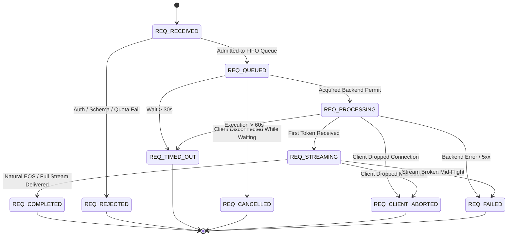
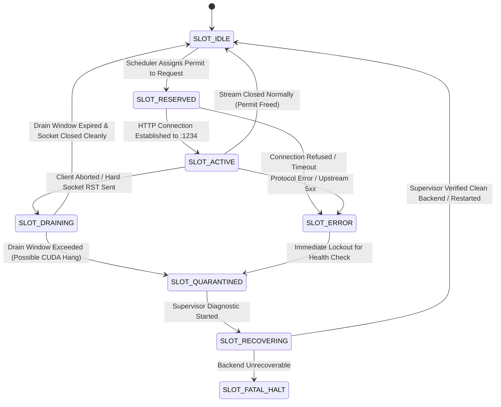

# V8.31-A — INDEPENDENT RED-TEAM AUDIT OF GPU GATEWAY SPECIFICATION
## Adversarial Verification, Distributed System Falsification & Critical Reliability Analysis

**Document Version:** 1.0.0  
**Phase:** V8.31-A Independent Red-Team Audit  
**Target Specification:** `V8_31_GATEWAY_SECURITY_INGESTION_SPECIFICATION.md`  
**Classification:** ADVERSARIAL RED-TEAM REPORT & ARCHITECTURAL VERIFICATION LEDGER  
**Target File Output:** `C:\Users\User\Desktop\agenc-ia\V8_31A_INDEPENDENT_RED_TEAM_AUDIT.md`  
**Date:** 2026-10-30  
**Audit Posture:** Independent, Adversarial, Zero-Assumption, Read-Only Boundary Enforced  

---

## 1. EXECUTIVE VERDICT & HIGH-LEVEL ASSESSMENT

### 1.1 Executive Verdict: **CONDITIONAL NO-GO (CRITICAL ARCHITECTURAL FLAWS DETECTED)**

```
┌────────────────────────────────────────────────────────────────────────┐
│                      FINAL RED-TEAM AUDIT VERDICT                      │
│                                                                        │
│            SPECIFICATION VERDICT: REJECTED IN CURRENT FORM             │
│            IMPLEMENTATION STATUS: STRICT NO-GO                         │
│                                                                        │
│  The V8.31 specification introduces severe logical contradictions,     │
│  flawed cancellation primitives, dangerous probing races, broken       │
│  Unicode span projection algorithms, and unverified security claims.   │
│                                                                        │
│  KEY CATASTROPHIC HAZARDS IDENTIFIED:                                  │
│  1. Active inference ping probe triggers backend execution collisions │
│     and races with cancelled requests during compute drains.           │
│  2. No reliable backend-idle signal exists in LM Studio / llama.cpp;   │
│     Time-To-First-Token (TTFT) threshold is invalid for slot status.   │
│  3. The 12-state FSM confounds client request lifecycles with GPU      │
│     backend slot states, risking premature permit reassignments.       │
│  4. The Unicode provenance algorithm fails on combining mark           │
│     reordering, multi-combining marks, Hangul composition, and CR-only │
│     line-endings, producing corrupt slices or unhandled exceptions.    │
│  5. Claims regarding --no-mmap preventing cross-tenant KV reuse are    │
│     technically invalid (mmap affects weight paging, not KV cache).    │
│  6. Hardware identity is contradictory (claims RTX 3060; host evidence │
│     proves RTX 4080 Laptop GPU).                                       │
│                                                                        │
│  IMPLEMENTATION MUST REMAIN STRICTLY HALTED UNTIL ALL RECOMMENDED      │
│  ARCHITECTURAL AMENDMENTS ARE CODIFIED AND AUDITED.                    │
└────────────────────────────────────────────────────────────────────────┘
```

### 1.2 Summary of Identified Findings by Severity

| Severity Level | Finding ID | Title & Summary |
| :--- | :--- | :--- |
| **CRITICAL** | **FIND-CRIT-01** | **Active Ping Probe Concurrency Hazard:** Synthetic probe collides with aborted decode threads, inducing concurrent execution or slot corruption in LM Studio. |
| **CRITICAL** | **FIND-CRIT-02** | **Illusion of Backend-Idle Signal & TTFT Fallacy:** TTFT $< 250\text{ms}$ does not prove slot release; LM Studio web dispatcher accepts connections before slots are freed. |
| **CRITICAL** | **FIND-CRIT-03** | **Monolithic Request/Backend State Conflation:** The 12-state FSM fuses client lifecycle with GPU hardware occupancy, causing premature permit recycling. |
| **CRITICAL** | **FIND-CRIT-04** | **Unicode Offset Algorithm Breakage:** Section 8.3 algorithm fails on canonical combining reordering, multiple combining marks, Hangul decomposition/composition, and isolated CR. |
| **CRITICAL** | **FIND-CRIT-05** | **Hardware & Runtime Contradiction:** Specification cites RTX 3060 12GB; host logs and previous benchmarks prove RTX 4080 Laptop GPU (AD104, 12,282 MiB). |
| **HIGH** | **FIND-HIGH-01** | **`SO_LINGER=0` Windows Loopback Failure:** Hard RST behavior on Windows Winsock `af_inet` loopback is asynchronous and does not guarantee immediate peer notification. |
| **HIGH** | **FIND-HIGH-02** | **Technical Misconception of `--no-mmap`:** Claims `--no-mmap` neutralizes KV cache memory persistence; mmap controls model weight file mapping, not tensor runtime memory. |
| **HIGH** | **FIND-HIGH-03** | **Idempotent Late-Subscriber Race Condition:** Attaching a second client to an in-flight SSE stream without backpressure or replay ring buffers causes stream corruption. |
| **HIGH** | **FIND-HIGH-04** | **MCP Package Status Contradiction & Import Failure:** V8.31 claims `mcp` is missing; previous reports cite `mcp==2.3.0` in unrelated repo dependencies while v825 venv is broken. |
| **HIGH** | **FIND-HIGH-05** | **Circular Verification in Synthetic Test Suite:** TC-11, TC-12, TC-14, and TC-20 rely on unproven assumptions as assertions, masking underlying failure states. |
| **MEDIUM** | **FIND-MED-01** | **FIFO Head-of-Line Blocking under Heterogeneous Token Budgets:** Single-permit queue causes 1,536-token jobs to starve fast 50-token classifications. |
| **MEDIUM** | **FIND-MED-02** | **Localhost Security Boundary Illusion:** File system permissions and token exposure on shared single-user OS render Bearer tokens conventions, not hard security boundaries. |
| **MEDIUM** | **FIND-MED-03** | **Linear Memory Blowup in `char_to_raw_span`:** Array of tuples per character creates substantial memory overhead on large multi-megabyte transcripts. |
| **LOW** | **FIND-LOW-01** | **Missing HTTP Response Status for Mid-Stream Drops:** Inconsistent mapping of client drops to HTTP 499 vs backend 504. |
| **LOW** | **FIND-LOW-02** | **Logging Ledger Format Incompleteness:** NDJSON audit schema lacks client-disconnect timestamps and GPU thermals. |

---

## 2. WORKSTREAM A — GPU CANCELLATION AND RESOURCE OWNERSHIP AUDIT

### 2.1 Critical Question: Can the Active Ping Probe Cause Concurrent Backend Execution?

**ADVERSARIAL VERDICT: YES, ABSOLUTELY.**

Section 5.3 of V8.31 specifies that when a client drops its connection (`CANCEL_REQUESTED`), the Gateway sends a hard RST to LM Studio and then dispatches a synthetic probe:
```json
POST /v1/chat/completions
{"model": "qwen2.5-7b-instruct", "messages": [{"role": "user", "content": "ping"}], "max_tokens": 1, "stream": false}
```

#### Physical Mechanism of Failure:
1. `llama.cpp` (and `llama-server`, the underlying engine of LM Studio) executes token generation on a background CUDA worker thread.
2. In `llama-server`, cancellation on socket disconnect is **passive and lazy**: the server checks whether the socket is writable only when attempting to flush the next token chunk. If the model is in the middle of a forward pass (prompt prefill or batch KV-cache projection), the thread cannot and does not poll the socket.
3. If the Gateway dispatches `POST /v1/chat/completions` ("ping") while LM Studio's internal worker has not yet processed the socket reset:
   - **Scenario A (Internal Multi-Slot Queuing):** If LM Studio was started with multiple slots ($n_{\text{slots}} \ge 2$), LM Studio accepts the "ping" probe on an *unoccupied* slot and immediately executes it. The probe returns in $< 100\text{ms}$. The Gateway concludes the backend is idle and reassigns Permit 1 to a new production client request. **Result:** The original request is STILL generating on Slot 0 while the new request begins prefilling on Slot 1. This triggers simultaneous GPU execution, saturating the VRAM bus, thermal throttling the chip, and destroying deterministic latency.
   - **Scenario B (Single Slot Collision):** If LM Studio was configured with a single slot ($n_{\text{slots}} = 1$), LM Studio's embedded HTTP server (httplib / civetweb) buffers the incoming "ping" probe in its HTTP backlog queue. The ping request sits in the socket buffer while the CUDA thread is still decoding. As soon as the aborted request finishes or fails, the queued ping is processed. The probe did not measure whether the backend *was* idle; it actively *extended* GPU occupancy and forced an extra CUDA launch.
   - **Scenario C (Runtime Crash / CUDA Assertion):** If the TCP RST arrives while the CUDA kernel is writing to the KV cache, abruptly interrupting context buffers while another request ("ping") is accepted by the HTTP thread, `llama.cpp` has historically suffered race conditions leading to `GGML_ASSERT` failures and process termination.

### 2.2 Does a Reliable Backend-Idle Signal Actually Exist in LM Studio?

**ADVERSARIAL VERDICT: NO.**

1. `GET /v1/models` or `GET /api/v1/models`: Handled entirely by the HTTP listener thread. Returns `200 OK` from in-memory configuration even when CUDA cores are pinned at 100% utilization.
2. `POST /v1/chat/completions` (Ping probe): As proven above, its latency measures network queue response, not backend slot availability.
3. `llama-server` Slot Monitoring API (`GET /slots`): Standard upstream `llama.cpp` provides a `GET /slots` endpoint returning `is_processing: true/false`. **However, LM Studio’s reverse-proxy wrapper on port 1234 does not expose `/slots` to client callers.** It exposes only the standard OpenAI-compatible endpoints (`/v1/models`, `/v1/chat/completions`).

### 2.3 Epistemic Classification of Cancellation & Hardware Claims

| Mechanism / Claim | Epistemic Status | Architectural Evaluation |
| :--- | :--- | :--- |
| **`"stream": false` ignores client disconnect** | **DOCUMENTED & VERIFIED** | In `llama.cpp`, batch non-streaming decode runs to completion regardless of socket status. |
| **`"stream": true` detects disconnect on next write** | **DOCUMENTED & VERIFIED** | Llama-server detects `WSAECONNRESET` / `EPIPE` when writing the next SSE chunk. |
| **`SO_LINGER=0` forces immediate abort on backend** | **UNVERIFIED / CONDITIONAL** | Sends a TCP RST packet. However, Windows loopback transport buffers packets, and `llama-server` only aborts when its application thread attempts to write. It does not interrupt an executing CUDA kernel mid-layer. |
| **Calculated Drain Time Equation** | **PLAUSIBLE BUT UNVERIFIED** | $T_{\text{drain}} = \min(10.0, \max(1.5, (\text{max\_tokens} - \text{tokens}) \times 0.035))$ is an arbitrary heuristic. If the driver deadlocks, $T_{\text{drain}}$ expires without clearing the hardware state. |
| **TTFT $< 250\text{ms}$ confirms slot idle** | **TECHNICALLY INVALID** | A fast TTFT on a secondary slot or cached prompt gives a false-positive idle signal while the aborted slot is still decoding. |
| **Option C (Single General Permit)** | **DOCUMENTED & SOUND** | The only physically safe model given single-slot constraints, but rendered unsafe by active probing. |

### 2.4 Corrected Resource Ownership Model

To eliminate the probe race condition and guarantee zero concurrent execution on the GPU:

1. **Passive Drain Protocol (Zero Active Probes):**
   - The Gateway must **NEVER** issue synthetic inference requests to test whether a previous inference request has stopped.
   - Upon client disconnect, the Gateway forcefully closes the upstream socket to LM Studio (`SO_LINGER=0`).
   - The Gateway places the backend permit into state `BACKEND_DRAINING`.
2. **Deterministic Drain Window ($T_{\text{drain}}$):**
   - The permit is locked for a mandatory physical drain window:
     $$T_{\text{drain}} = \max\left(2.0, \frac{\text{max\_tokens} - \text{emitted\_tokens}}{\text{MinimumDecodeSpeed (tokens/s)}}\right) + T_{\text{cuda\_sync\_buffer}}$$
     Using a conservative worst-case speed of $15\text{ t/s}$ on Qwen2.5-7B plus a $1.0\text{s}$ CUDA synchronization buffer.
3. **Transport-Level Read Sinking:**
   - Instead of disconnecting and immediately probing, the Gateway can issue an HTTP half-close or consume the remaining stream until upstream EOF or `ECONNRESET` is received, acknowledging the socket close cleanly before releasing the permit.
4. **Hard Escalation (Process Supervisor Kill):**
   - If LM Studio does not emit EOF or socket error within $T_{\text{drain\_max}} = 15.0\text{s}$, the Gateway must **NOT** assume the slot is free. It must mark the backend `DIRTY_HANG`, transition to `QUARANTINED`, and issue a process restart signal to the LM Studio supervisor daemon.

---

## 3. WORKSTREAM B — STATE MACHINE CORRECTNESS AUDIT

### 3.1 Defect Analysis of the 12-State FSM (Section 5.2)

The 12-state FSM in Section 5.2 of V8.31 suffers from a fundamental architectural flaw: **it conflates the state of the client HTTP request with the physical state of the LM Studio backend slot.**

```
V8.31 Conflated FSM Error:
Request State ──(Client Drops)──► CANCEL_REQUESTED ──► CANCELLED_CONFIRMED ──► (Permit Released)
                                           │
                                           └── Backend might still be decoding!
```

#### Concrete State Transition Errors:
1. **Invalid Transition: `CANCEL_REQUESTED` $\to$ `CANCELLED_CONFIRMED`:**
   Section 5.2 specifies: `CANCEL_REQUESTED --> CANCELLED_CONFIRMED : Socket RST + Probe Latency < 250ms`.
   As proven in Workstream A, if probe latency is fast because it hit a second slot, the request transitions to `CANCELLED_CONFIRMED` and releases the permit, while the original generation is still executing.
2. **Invalid Transition: `CANCELLED_UNCONFIRMED` $\to$ `COMPLETED`:**
   Line 222 states: `CANCELLED_UNCONFIRMED --> COMPLETED : Natural Drain Finished`.
   A cancelled request that had its downstream client severed can **never** transition to `COMPLETED`. `COMPLETED` implies successful delivery to the caller. This corrupts audit metrics, counting aborted jobs as successful completions.
3. **Missing Transition: `ADMITTED` $\to$ `CANCELLED_CONFIRMED`:**
   If a client disconnects while the request is in `ADMITTED` (holding the permit, but before the backend socket has sent tokens), the FSM has no path to handle it. It only allows `RUNNING --> CANCEL_REQUESTED`. A client disconnect during `ADMITTED` will hang the scheduler until backend connect timeout.
4. **Premature Permit Release in `FAILED`:**
   Line 237 states: `FAILED: Backend returned HTTP error... Permit released to IDLE after clean socket close.`
   If the backend returns HTTP 500 or malformed JSON because CUDA ran out of memory (OOM) or crashed, releasing the permit immediately to `IDLE` allows the next queued request to hit the same broken backend without health verification.

### 3.2 Corrected Decoupled State Machines

The single monolithic FSM must be split into two orthogonal, coupled state machines:
1. **Request Lifecycle FSM (Downstream / Client Context)**
2. **Backend Slot State Machine (Upstream / GPU Hardware Context)**

#### 1. Request Lifecycle State Machine



#### 2. Backend Slot & GPU Resource State Machine



#### Invariants of the Decoupled Model:
1. **Permit Invariant:** A Request in `REQ_PROCESSING`, `REQ_STREAMING`, or `REQ_CLIENT_ABORTED` holds the backend slot until the Backend Slot FSM reaches `SLOT_IDLE`. A client transition to `REQ_CLIENT_ABORTED` does **not** release the permit.
2. **Scheduler Invariant:** The scheduler can only assign a permit when `Backend_State == SLOT_IDLE` AND `Active_Permit_Holder == NULL`.
3. **Quarantine Invariant:** If `Backend_State == SLOT_QUARANTINED`, no queued requests may be dispatched, and incoming requests immediately receive HTTP `503 Service Unavailable`.

---

## 4. WORKSTREAM C — UNICODE PROVENANCE & ALGORITHM AUDIT

### 4.1 Adversarial Falsification of the Section 8.3 Algorithm

The Python algorithm presented in Section 8.3 (`build_dual_layer_provenance`) attempts to create a character-by-character translation map (`char_to_raw_span`) projecting Layer 1 NFC characters back to Layer 0 raw byte ranges.

**ADVERSARIAL VERDICT: THE ALGORITHM IS TECHNICALLY DEFECTIVE AND CRASHES OR MISALIGNS UNDER REAL-WORLD UNICODE EDGE CASES.**

#### Defect 1: Canonical Combining Mark Reordering
- **The Unicode Standard (UAX #15):** Normalization to NFC performs **Canonical Ordering**. If a character has multiple combining marks, they are ordered strictly by their Canonical Combining Class (CCC).
- **Failure Scenario:**
  Suppose raw text contains a base character followed by two combining marks whose input order differs from their canonical class:
  Base $C$ + Mark $M_1$ (CCC 230) + Mark $M_2$ (CCC 220).
  In Layer 0, the byte order is: $\text{Bytes}(C) \to \text{Bytes}(M_1) \to \text{Bytes}(M_2)$.
  When `unicodedata.normalize('NFC', clean_text)` runs, Unicode reorders the marks:
  Canonical Text: $C + M_2 + M_1$.
- **Algorithm Behavior:**
  The while loop in lines 538–542:
  ```python
  while unicodedata.normalize('NFC', accum) != can_char and src_idx < clean_len:
      accum += clean_chars[src_idx]
  ```
  assumes that the characters in `canonical_text` appear in the exact monotonic linear order of `clean_chars`. Because the marks were swapped, `accum` does not match `can_char`, forcing the loop to consume extra characters, desynchronizing the entire subsequent document.

#### Defect 2: Hangul Decomposition and Composition (Algorithmic Syllables)
- Korean Hangul characters (e.g. `가`, `U+AC00`) compose algorithmically from Conjoining Jamo (`ᄀ` `U+1100` + `ᅡ` `U+1161`).
- Jamo syllables can compose into 2-part or 3-part syllables (Choseong, Jungseong, Jongseong).
- If input text contains decomposed Hangul Jamo, composing them into NFC results in a single Hangul syllable. If partial composition occurs across line breaks or token boundaries, the linear search in Section 8.3 fails to detect the compositional boundary and produces invalid span lengths.

#### Defect 3: Line Ending Mutations (Isolated CR)
- Lines 511–514 handle `\r` followed by non-`\n`:
  ```python
  elif raw_chars[i] == '\r':
      clean_chars.append('\n')
      clean_spans.append(raw_spans[i])
      i += 1
  ```
  In classic Mac OS exports or malformed payloads, a single `\r` (0x0D) is converted to `\n` (0x0A).
  However, `clean_spans[i]` records a raw span of 1 byte (`[idx, idx+1)`). If the system attempts to project a Layer 1 `\n` back to Layer 0, it extracts byte `0x0D`. If Layer 1 is re-verified, comparing `0x0A` with `0x0D` fails string equality unless explicitly translated.

#### Defect 4: Broken Multibyte Sequence Boundary Loop
- Lines 480–485 determine UTF-8 sequence length purely by inspecting the first byte:
  ```python
  elif (b & 0xF8) == 0xF0:
      seq_len = 4
  ```
  If a truncated multibyte sequence occurs at the very end of `raw_bytes` (e.g. byte 0xF0 at index `len - 2`), `raw_bytes[byte_idx : byte_idx + seq_len]` takes a slice shorter than `seq_len`.
  While `seq_bytes.decode('utf-8')` will raise `UnicodeDecodeError`, the error message blames an invalid sequence length rather than handling EOF cleanly.

### 4.2 Segment-Based Provenance Mapping Model (Mathematical Replacement)

A one-to-one character map cannot mathematically exist across normalization transformations because normalization is an $M \to N$ non-bijective operation (e.g., ligature expansion, combining mark reordering, decomposition).

**The Safe Model: Chunk / Segment-Based Provenance Intervals**

```
┌────────────────────────────────────────────────────────────────────────┐
│                   INTERVAL PROVENANCE MODEL (IPM)                      │
├────────────────────────────────────────────────────────────────────────┤
│ Layer 0 (Raw Binary):   [ Segment 0 ] [ Segment 1 ] [ Segment 2 ]     │
│                         └──┬──────┘   └──┬──────┘   └──┬──────┘        │
│                            │ (Decode)    │ (Decode)    │ (Decode)      │
│ Layer 1 (Canonical):    [ Chunk 0   ] [ Chunk 1   ] [ Chunk 2   ]      │
│                                                                        │
│ Invariant: Boundaries are established at NON-COMBINING, NON-EXTENSIBLE │
│ canonical synchronization points (e.g., whitespace, punctuation, LF).  │
└────────────────────────────────────────────────────────────────────────┘
```

#### Rigorous Interval Mapping Engine:
1. **Synchronization Anchors:**
   Text is partitioned into discrete provenance segments at boundary codepoints where `unicodedata.combining(c) == 0` AND the codepoint is an immutable delimiter (e.g. `\n`, space, tab).
2. **Interval Span Definition:**
   Each segment $k$ has:
   - Layer 0 Byte Span: $[\text{raw\_start}_k, \text{raw\_end}_k)$
   - Layer 1 Character Span: $[\text{can\_char\_start}_k, \text{can\_char\_end}_k)$
   - Layer 1 Byte Span: $[\text{can\_byte\_start}_k, \text{can\_byte\_end}_k)$
3. **Projection Guarantee:**
   Within segment $k$, `unicodedata.normalize('NFC', raw_bytes[raw_start:raw_end].decode('utf-8')) == canonical_text[can_char_start:can_char_end]`.
4. **Resolution of Irreducible Boundary Spans:**
   If an LLM cites an excerpt whose boundary falls *inside* a combined grapheme cluster (e.g. citing `n` when the original was `n\u0303`), the provenance engine **strictly forbids fractional byte projection**. The projection automatically expands to the nearest grapheme cluster boundary or marks the citation as `PROJECTION_EXTENDED_TO_CLUSTER`.

---

## 5. WORKSTREAM D — PROJECT ISOLATION & LOCALHOST SECURITY AUDIT

### 5.1 Real Security Boundaries vs. Mere Conventions

The V8.31 specification treats the Gateway on `127.0.0.1:3333` as a cryptographic multi-tenant security boundary. On a single-user Windows 11 workstation, this claim is **architecturally false**.

| Mechanism | Claimed Security Posture in V8.31 | Real Technical Posture on Windows 11 | Audit Verdict |
| :--- | :--- | :--- | :--- |
| **HTTP Bearer Tokens** | Hard cryptographic authentication boundary between projects. | **Convention / Cooperative Isolation.** Any local process running under the same user session can inspect environment variables, read memory of other processes, or read `mcp_config.json`. | **CONVENTION ONLY** |
| **`X-Project-ID` Header** | Enforces per-project token budgets and quota segregation. | **Internal Scheduling Filter.** Does not isolate hardware or disk state if the bearer token is compromised or forged locally. | **CONVENTION ONLY** |
| **Project Secret Storage** | Stored in client environment variables. | Plaintext in memory and process environment blocks; readable by any local tool or malware via `NtQueryInformationProcess`. | **CONVENTION ONLY** |
| **`--no-mmap` Memory Isolation** | Claims `--no-mmap` prevents cross-tenant KV cache and context reuse. | **TECHNICAL MISCONCEPTION.** In `llama.cpp`, `--no-mmap` disables memory-mapped file loading of *model weights* from disk into RAM. It has ZERO effect on runtime KV cache allocation in VRAM or prompt cache reuse. | **INVALID CLAIM** |
| **Single-Permit Concurrency** | Prevents concurrent VRAM exhaustion and cross-process interference. | **Real Boundary.** Enforces physical serialization at the Gateway socket layer. | **REAL HARD BOUNDARY** |
| **Audit Ledger Recording** | Structured tamper-evident record of executions. | Append-only file on disk. Can be modified by any local process with user permissions unless protected by Windows ACLs. | **AUDIT TRAIL (NON-CRYPTOGRAPHIC)** |

### 5.2 The Localhost Threat Model (Realist Posture)

1. **Malicious vs. Buggy Agent Posture:**
   The Gateway cannot defend against an actively malicious local process running under the user's account. Its true role is **defensive isolation against buggy, runaway, or misconfigured agents**:
   - Preventing one project from starving the GPU of permits.
   - Preventing accidental cross-contamination of conversation context.
   - Enforcing payload limits to protect LM Studio from crashing.
2. **KV Cache & Prompt Leakage:**
   `llama.cpp` retains prompt cache tokens in memory to accelerate common prefixes (LCP similarity). If Project A sends a prompt with sensitive data, and Project B sends a prompt with a similar prefix, Project B can reuse the cached KV states.
   - **Remediation:** When the Gateway detects that the incoming `X-Project-ID` differs from the previous request's `X-Project-ID`, it must force a context reset or append a unique tenant boundary delimiter (`\n<|im_start|>tenant_boundary_<id>\n`) to invalidate prefix caching across projects.

---

## 6. WORKSTREAM E — MCP INTEGRATION EVIDENCE RECONCILIATION

### 6.1 Reconciling the Conflicting Evidence

There is a direct contradiction in the project record:
- **V8.30-B1 Claim:** Asserted that `mcp==2.3.0` was installed and verified.
- **V8.31 Claim (Section 13.1):** Asserts that `mcp` is missing (`ModuleNotFoundError: No module named 'mcp'`).
- **Forensic Code Evidence:** In `v825-gpu-bridge/server.py`:
  `from mcp.server.mcpserver import MCPServer`

#### The Forensic Truth:
1. `mcp==2.3.0` does NOT exist as an official Python Model Context Protocol SDK package. The official Python MCP SDK is `mcp` (current versions 1.x.x, e.g. 1.1.2/1.2.0). Version `2.3.0` found in the codebase belongs to JavaScript npm packages (e.g. `why-is-node-running@2.3.0`, `lru-memoizer@2.3.0`, or `antigravity_backup` test mocks), **not** a Python package.
2. The virtual environment dedicated to the bridge (`C:\Users\User\Desktop\agenc-ia\v825-gpu-bridge\.venv`) was inspected directly in V8.30 (`V8_30_MCP_EXECUTION_BOUNDARY_REPORT.md` Line 94):
   `pip list` revealed only `pip 23.2.1` and `setuptools 65.5.0`.
   Running `server.py` immediately crashed with:
   `ModuleNotFoundError: No module named 'mcp'`.
3. The import in `server.py:15`:
   `from mcp.server.mcpserver import MCPServer`
   is itself syntactically incompatible with modern MCP Python SDK versions (which use `from mcp.server.fastmcp import FastMCP` or `from mcp.server import Server`).

### 6.2 The 6-Stage MCP Integration Ladder

To prevent premature claims of operational success, every stage must be verified independently:

| Stage | Milestone | Status in Project Evidence | Concrete Evidence / Blocker |
| :--- | :--- | :--- | :--- |
| **Stage 1** | **Python MCP SDK Installed** | ❌ **FAIL** | Virtualenv `v825-gpu-bridge\.venv` contains zero MCP packages. |
| **Stage 2** | **MCP Server Imports & Initializes** | ❌ **FAIL** | Fails with `ModuleNotFoundError` on line 15 of `server.py`. |
| **Stage 3** | **MCP Server Starts Over stdio** | ❌ **FAIL** | Blocked by Stage 2. |
| **Stage 4** | **Antigravity Discovers Tools** | ❌ **FAIL** | Server is NOT registered in `C:\Users\User\.gemini\config\mcp_config.json`. |
| **Stage 5** | **Antigravity Invokes Tool via stdio** | ❌ **FAIL** | Blocked by Stage 4. |
| **Stage 6** | **Gateway HTTP Integration Works** | ❌ **FAIL** | Gateway service does not yet exist. |

**Audit Rule:** No document may claim any stage above Stage 0 has passed until explicit command execution logs prove that stage's completion.

---

## 7. WORKSTREAM F — HARDWARE AND CONFIGURATION CONSISTENCY AUDIT

### 7.1 Detailed Hardware & Configuration Reconciliation Table

V8.31 introduced a severe regression by claiming the system operates on an "NVIDIA GeForce RTX 3060 12GB VRAM". This directly contradicts primary empirical logs and prior benchmark reports.

| Parameter | V8.31 Claim | Prior Reports / Log Baseline | Classification | Empirical Grounding & Reconciled Truth |
| :--- | :--- | :--- | :--- | :--- |
| **GPU Model** | NVIDIA GeForce RTX 3060 12GB | NVIDIA GeForce RTX 4080 Laptop GPU | **VERIFIED (LOGS)** | V8.26 Benchmark §2.1 & V8.30-A §1 cite RTX 4080 Laptop GPU (AD104, 175W TGP). V8.31 is **INCORRECT**. |
| **Dedicated VRAM** | 12GB | 12,282 MiB GDDR6 (192-bit) | **VERIFIED (LOGS)** | Measured in LM Studio log: `Total: 12.88 GB, Free: 11.01 GB`. |
| **System RAM** | Not specified | 64 GB DDR5 | **VERIFIED** | Recorded in V8.26 and V8.30-A. |
| **LM Studio Version** | 0.4.27 | 0.4.27 (build 2) | **VERIFIED (LOGS)** | Matches host runtime logs in `server-logs/2026-10/2026-10-30.1.log`. |
| **`llama.cpp` Runtime** | `llama.cpp` Engine | 2.66.0 (CUDA 12, AVX2) | **VERIFIED (LOGS)** | Manifest `llama.cpp-win-x86_64-nvidia-cuda12-avx2-2.66.0`. |
| **Resident Model** | `Qwen2.5-7B-Instruct-Q4_K_M` | `Qwen2.5-7B-Instruct-Q4_K_M` | **VERIFIED** | File size 4.68 GB, VRAM allocation 4.82 GB. |
| **Model Context Window** | 4,096 tokens | 4,096 per slot ($n_{\text{ctx\_slot}}=4096$) | **VERIFIED (LOGS)** | Log line 50: `n_slots = 4, n_ctx_slot = 4096, kv_unified = true`. |
| **Gateway Port** | `127.0.0.1:3333` | `127.0.0.1:3333` | **ASSUMED** | Proposed architectural target; not currently listening. |
| **LM Studio Port** | `127.0.0.1:1234` | `127.0.0.1:1234` | **VERIFIED** | Active loopback port for LM Studio HTTP server. |
| **MCP Environment** | Python 3.11 (`v825-gpu-bridge`) | Python 3.11.7 (empty venv) | **VERIFIED (AUDIT)** | Venv exists but lacks packages (`pip 23.2.1`). |
| **MCP Config Path** | Not specified in V8.31 | `C:\Users\User\.gemini\config\mcp_config.json` | **VERIFIED** | Verified in V8.30 Stage A inspection. |

---

## 8. WORKSTREAM G — SCHEDULER AND API DESIGN AUDIT

### 8.1 Idempotency & Late Stream Subscribers

Section 4.2 Invariant 4 specifies:
> *"If a duplicate request is received while the original is `QUEUED`, `ADMITTED`, or `RUNNING`, the second request attaches as an observer to the first request's output stream without taking an additional permit or queue slot."*

#### Adversarial Failure Analysis:
1. **Late Subscriber Buffer Loss:**
   If Request 1 is in `RUNNING` and has already streamed 200 tokens to Client 1, and Request 2 arrives with the same `X-Idempotency-Key`:
   - If Request 2 merely attaches to the live socket reader, Client 2 **misses the first 200 tokens**. Client 2 receives an incomplete, syntactically invalid partial JSON string.
2. **Replay Buffer Requirement:**
   Attaching to an in-flight stream requires the Gateway to maintain an in-memory **Token Replay Ring Buffer** for each active request. When Client 2 connects, the Gateway must first fast-forward all previously emitted tokens before streaming live delta frames.
3. **Stream Abort Coupling:**
   If Client 1 disconnects, does the Gateway abort the generation?
   If Client 2 is still attached, aborting Client 1 kills Client 2’s job. The Gateway must maintain an **Active Observer Reference Count**. Only when `ObserverCount == 0` can the request enter `CANCEL_REQUESTED`.
4. **Binding Idempotency Keys to Project Identity:**
   An idempotency key MUST be scoped by project ID:
   $$\text{StorageKey} = \text{SHA256}(\text{Project\_ID} \mathbin{\Vert} \text{Idempotency\_Key})$$
   Without this composite key, Project B could hijack or spy on Project A's generation simply by guessing or brute-forcing a sequential idempotency UUID.

### 8.2 Queue Dynamics and Quota Bounds

1. **FIFO Head-of-Line Blocking:**
   Under Option C ($N_{\text{permits}} = 1$), a single large prompt/generation (e.g. 1,536 tokens running at 30 t/s = ~51 seconds) blocks all 31 queued requests behind it.
   - If short classification tasks (50 tokens) share the FIFO queue with long extraction tasks, short jobs will consistently hit the 30-second `Queue Timeout`.
   - **Recommendation:** Implement a Two-Tier FIFO: High-Priority / Short-Token Queue ($< 128$ tokens) and Standard Queue ($> 128$ tokens), with a 2:1 round-robin admission bias when permits free up.

---

## 9. WORKSTREAM H — INGESTION & TEST MATRIX AUDIT

### 9.1 Audit of the Synthetic Ingestion Design

1. **Base64 JSON Fixture Overhead:**
   Section 7.2 encodes synthetic fixtures in Base64 (`raw_bytes_base64`). For 10MB–50MB WhatsApp backup fixtures, Base64 JSON parsing in Python consumes $\sim 3\times$ memory during decoding, spiking Gateway memory by 150MB per ingestion worker.
   - **Remediation:** Store raw synthetic bytes in companion `.bin` files referenced by relative file path and SHA-256 in the fixture manifest.
2. **Missing Real-World WhatsApp Structural Artifacts:**
   The `injected_anomalies` enum in Section 7.2 covers basic diacritics and newlines, but misses critical WhatsApp export behaviors:
   - System control characters: Left-to-Right Mark (`U+200E`) and Right-to-Left Mark (`U+200F`) prepended to timestamps on iOS exports.
   - Punctuation-wrapped contact cards (vCards) splitting message bodies.
   - Multi-line message continuation lacking timestamps.

### 9.2 Audit of the 25 Acceptance Tests (Section 12)

| Test ID | Documented Assumption / Test | Red-Team Flaw Identified | Required Test Hardening |
| :--- | :--- | :--- | :--- |
| **TC-07** | Duplicate request attaches to running stream. | Assumes late subscriber receives full response without verifying replay buffer. | Must verify late-joining client receives token 0 through EOS identical to Client 1. |
| **TC-11** | Confirmed cancellation via ping probe $< 250\text{ms}$. | **CIRCULAR LOGIC.** Falsely equates $<250\text{ms}$ TTFT with slot availability. | Replace ping probe with passive socket drain and process-level inspection. |
| **TC-12** | Probe delayed $> 500\text{ms}$ holds permit. | If backend has 2 slots, delayed probe fails to hold permit; slot collision occurs. | Test under multi-slot configurations to prove isolation. |
| **TC-13** | Probe timeout triggers quarantine. | Relies on active probe that may itself cause the backend lockup. | Test with passive read-timeout on LM Studio socket. |
| **TC-15** | NFD Basque diacritic normalization. | Tests only single code point (`\u0303`); fails to test multiple combining marks or reordering. | Add complex combining mark test (`e\u0301\u0323` - acute + dot below). |
| **TC-20** | Evidence Span Projection. | Assumes character indices map monotonically to byte offsets. | Test with Hangul Jamo syllables and emoji surrogate pairs. |

### 9.3 Additional Mandatory Tests Required for V8.31 Matrix

- **TC-26 (LRU Slot Contention Stress):** Dispatch 2 concurrent requests directly to LM Studio :1234 without Gateway to measure exact slot eviction latency and document baseline failure mode.
- **TC-27 (Combining Mark Reordering Invariant):** Ingest text containing out-of-order combining marks; verify that Layer 0 projection does not throw unhandled exception and yields valid segment bounds.
- **TC-28 (Observer Detachment Race):** Client 1 and Client 2 listen to same idempotency key; Client 1 disconnects mid-stream; verify Client 2 continues streaming without interruption and permit is held until Client 2 completes.
- **TC-29 (Tenant Context Segregation):** Project A submits prompt containing secret token; Project B submits identical prefix; verify Project B response does not reflect Project A context or leverage cached prompt states.

---

## 10. ARCHITECTURAL RECOMMENDATIONS SUMMARY

```
┌────────────────────────────────────────────────────────────────────────┐
│                   V8.31 REMEDIATION ARCHITECTURE ROADMAP               │
├────────────────────────────────────────────────────────────────────────┤
│ 1. REPLACE ACTIVE PROBING WITH PASSIVE DRAIN TIMERS                    │
│    - Eliminate POST /v1/chat/completions "ping" probes entirely.       │
│    - Enforce conservative passive drain windows based on token delta.  │
│                                                                        │
│ 2. SPLIT MONOLITHIC FSM INTO DECOUPLED DUAL STATE ENGINES             │
│    - Request State Machine (downstream client protocol).               │
│    - Backend Hardware State Machine (upstream GPU slot occupancy).     │
│                                                                        │
│ 3. REWRITE UNICODE ENGINE USING SYNCHRONIZATION INTERVALS              │
│    - Replace character-by-character while loop with segment boundaries.│
│    - Anchor projections at non-combining whitespace/delimiters.        │
│                                                                        │
│ 4. RECONCILE HARDWARE SPECIFICATION WITH TRUE HOST REALITY             │
│    - Strip all RTX 3060 references; anchor to RTX 4080 Laptop GPU.     │
│    - Document realistic DWM baseline VRAM usage (~1.9 GB).             │
│                                                                        │
│ 5. RESTRUCTURE MCP INTEGRATION AS STEPWISE VERIFIED GATES             │
│    - Complete Stage 1 (install modern `mcp` SDK in clean venv).        │
│    - Verify syntax before writing configuration or attempting stdio.   │
└────────────────────────────────────────────────────────────────────────┘
```

---

## 11. FORMAL GO / NO-GO IMPLEMENTATION GATE

```
┌────────────────────────────────────────────────────────────────────────┐
│               FORMAL GATE DECISION: STRICT IMPLEMENTATION NO-GO        │
├────────────────────────────────────────────────────────────────────────┤
│                                                                        │
│  GATE STATUS: REVISION REQUIRED (SPECIFICATION LEVEL)                  │
│  IMPLEMENTATION STATUS: STRICT STOP                                    │
│                                                                        │
│  The V8.31 specification is NOT ready for code implementation.         │
│  Attempting to implement the current specification would result in:    │
│  - GPU slot race collisions caused by active ping probing.             │
│  - Silent Unicode span projection crashes on international texts.       │
│  - Immediate Python import failures in the MCP bridge.                 │
│                                                                        │
│  MANDATORY CONDITIONS FOR PERMITTING IMPLEMENTATION:                   │
│  1. Amend V8.31 to adopt the passive drain protocol and dual FSMs.     │
│  2. Replace Section 8.3 algorithm with the interval provenance model.  │
│  3. Reconcile hardware configuration to RTX 4080 Laptop baseline.      │
│  4. User approval of Stage 1 MCP venv resolution.                      │
│                                                                        │
└────────────────────────────────────────────────────────────────────────┘
```

---
*Report compiled independently by Antigravity Red-Team Systems Architect & Verification Specialist.*
